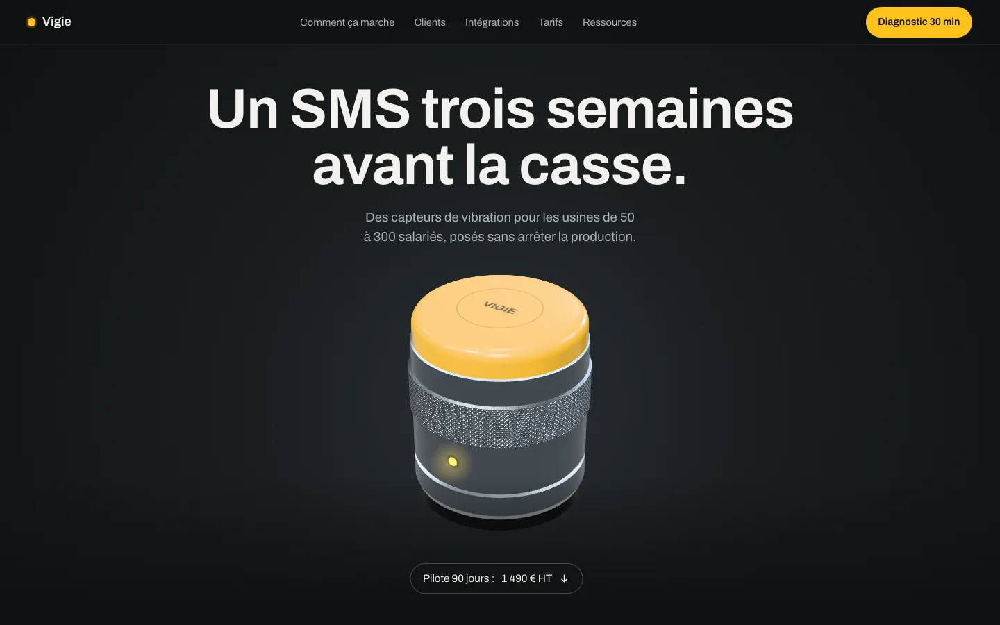
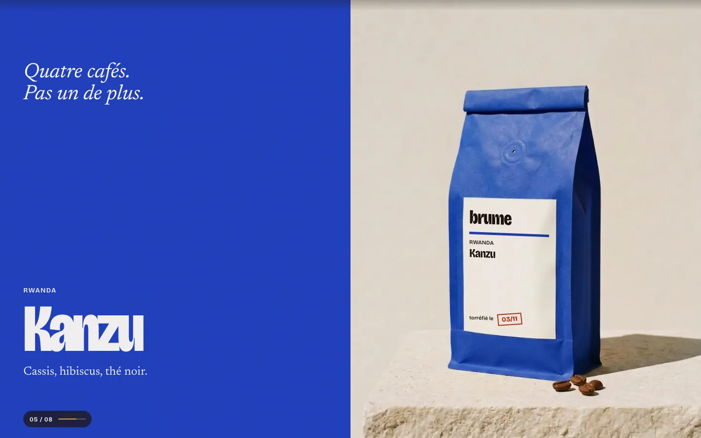
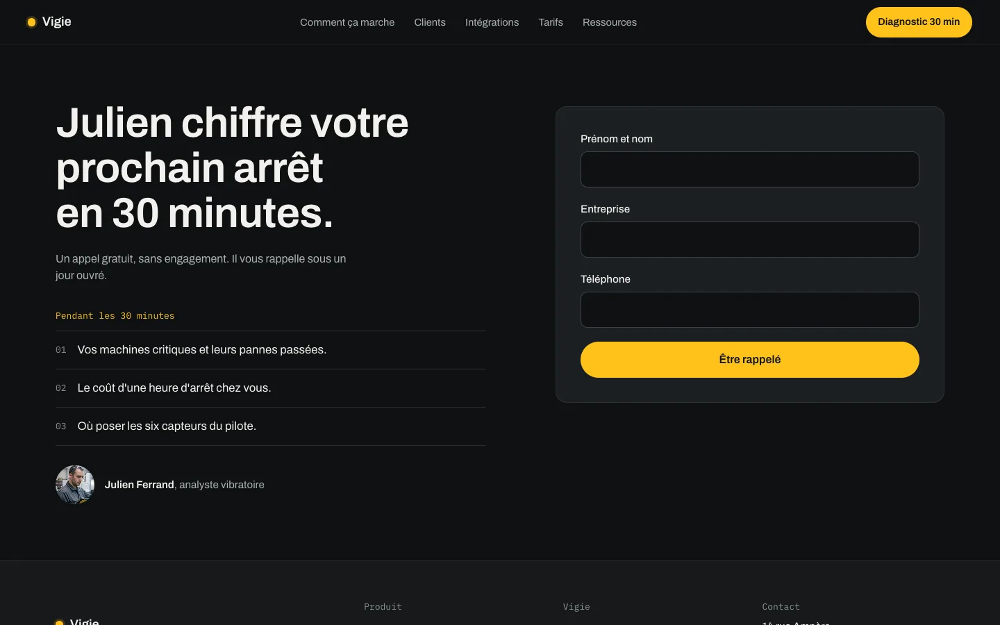

<p align="center">
  
</p>

<p align="center">
  
  
  
  
  
</p>

<p align="center">
  <b>Un plugin pour Claude Code qui t'accompagne de l'idée jusqu'au site web en ligne.</b><br>
  Il te pose les bonnes questions, fait les recherches, écrit les documents, dessine, code et déploie.<br>
  Tu valides chaque étape.<br>
  <b>Tout se fait dans Claude Code, de A à Z</b> — la maquette se dessine sur un canevas Claude Design ouvert depuis Claude Code.
</p>

<p align="center">
  <a href="#-installer-en-2-minutes">Installer</a> ·
  <a href="#des-exemples-pas-un-gabarit">Les exemples</a> ·
  <a href="#-objets-3d-dans-blender">La 3D</a> ·
  <a href="#%EF%B8%8F-le-parcours">Le parcours</a> ·
  <a href="#-les-commandes">Les commandes</a> ·
  <a href="#-questions-fréquentes">FAQ</a>
</p>

<p align="center">
  <a href="https://raw.githack.com/ohvignas/lancetonsite/main/skills/maquette/templates/exemples/index.html"><b>🖼️ Ouvrir la vitrine des 12 exemples en ligne →</b></a><br>
  <sub>ou dans le dépôt : <a href="skills/maquette/templates/exemples/index.html"><code>skills/maquette/templates/exemples/index.html</code></a></sub>
</p>

---

## 🤔 C'est quoi ?

> ⏱️ **Pressé ?** `/lancetonsite:express` : un site vitrine **en ligne en une heure**
> (un questionnaire, une fiche d'une page, le site codé directement par une équipe
> d'agents, deux validations, mise en ligne). Le parcours complet ci-dessous, lui, vise
> le niveau agence : compter environ 2 h 30 en rythme rapide.

Créer un bon site, ce n'est pas commencer par les couleurs. Une agence suit toujours le
même ordre : **comprendre** le client et sa cible, définir la **marque**, dessiner
l'**identité**, organiser les **pages**, écrire les **textes**, et seulement ensuite
**designer**, **coder** et **mettre en ligne**.

Lance ton site fait suivre cet ordre à Claude. Chaque étape :

1. 📖 **relit** ce qui a été décidé avant (tu ne répètes jamais deux fois la même chose) ;
2. 💬 te pose **une question à la fois**, avec des choix concrets ;
3. 🔎 **cherche** ce qui manque (avis clients, concurrents, mots-clés…) ;
4. 📄 **écrit un document** clair dans le dossier `projet-site/` ;
5. 🧐 le fait **relire** par un relecteur indépendant qui traque le flou et le « fait par IA » ;
6. ✅ attend **ton feu vert** avant de passer à la suite.

⚡ **Une équipe d'agents en parallèle.** À chaque étape, tout ce qui peut se faire en
même temps part en même temps : un agent par concurrent lu, par page écrite, par page
maquettée, par page construite, par contrôle. Ces agents tournent en Sonnet (rapides) ;
les choix de direction restent à l'agent principal. Détail : `commun/agents.md`.

**Le niveau visé : un site d'agence à 25 000 €.** Grandes images et vidéos plein cadre,
narration au défilement façon pages produit Apple, une animation ou une interaction
dans chaque section, le tout en **Tailwind CSS v4**, **GSAP** (ScrollTrigger, SplitText)
et **Lenis**. Aucune limite de création : photos, vidéos en boucle, objets détourés
générés avec fal ou OpenRouter, sur un seul budget fixé au départ, et **objets 3D
modélisés dans Blender** (gratuit, par script, sans que tu ouvres Blender). Le plugin embarque un kit de
gestes prêt à l'emploi et une grille notée sur 100 : une maquette sous 85 (90 avec tes
vraies photos) est reprise avant de t'être montrée.

**La boucle persona : l'IA teste et améliore son propre travail.** Avant de te montrer
la maquette, puis avant la mise en ligne, un agent devient ton client : le patron qui a
payé 25 000 €, puis l'acheteur que décrit ton cadrage. Il ouvre la page dans un vrai
navigateur, sur ordinateur et téléphone, clique, remplit, tabule au clavier, la note sur
100 et dit s'il paierait. Claude corrige d'après son plan, un nouvel agent reteste :
jusqu'à 3 tours. Sur les projets de test : 71 → 83 → 88, et 85 → 93.

### Des exemples, pas un gabarit

Douze pages d'exemple faites avec le plugin, au moins une par composition. Même kit de
gestes, des pages qui ne se ressemblent pas. Marques fictives. Toutes sont réunies sur
**la vitrine** : [en ligne](https://raw.githack.com/ohvignas/lancetonsite/main/skills/maquette/templates/exemples/index.html)
ou dans le dépôt ([`exemples/index.html`](skills/maquette/templates/exemples/index.html)).

#### Nouveau : trois pages construites autour d'un objet en 3D

| **Ciste**, parfumerie artisanale à Grasse (commerce) |
|---|
|  |
| **Produit centré** : le flacon est modélisé et rendu dans **Blender** (verre épais, jus coloré, étiquette papier, bague moletée, bouchon en céramique) ; il tourne au défilement, change de parfum, puis se décompose en notes. Catalogue, coffret, atelier sur réservation. Client simulé 79 → 88 « Oui ». |

| **Refuge de la Vire**, refuge gardé à 2 140 m (hébergement) | **Calorie**, pompes à chaleur dans le Luberon (artisan) |
|---|---|
|  |  |
| **Immersif plein écran** : la montagne, rendue en code, change d'heure au défilement, de l'aube à la nuit ; calendrier des dates libres et demande de réservation. Client simulé 80 → 85 « Oui ». | **Interface en démonstration** : relevé vivant dès le premier écran, maison en coupe en 3D où l'on suit la chaleur, simulateur d'aides et comparatif. Client simulé 77 → 75 → 89 « Oui ». |

<p align="center">
  
  <br><sub>Ciste au défilement, chaque image rendue dans Blender : le flacon tourne, change de parfum, puis se décompose en notes.</sub>
</p>

#### Les huit compositions

| **Brume**, torréfacteur à Marseille (B2C) | **Vigie**, capteur pour l'industrie (B2B) |
|---|---|
|  |  |
|  |  |
| **Immersif plein écran** : une suite d'écrans pleins, la torréfaction avance quand on descend, puis boutique avec panier, abonnement, équipe, journal. 655 mots, client simulé 81 → 88 « Oui » sur la refonte du 4 novembre. | **Produit centré** : l'objet tourne, s'ouvre en pièces, puis la courbe et l'alerte SMS ; page complète de 13 sections. 744 mots, client simulé 86 « Oui » sur la refonte du 4 novembre. |

| **Atelier Calade**, architecte dans le Vaucluse (libéral) | **Sillon**, panier bio près de Nantes (abonnement) |
|---|---|
|  |  |
| **Éditorial magazine** : couverture, sommaire, article avec fiche technique, honoraires publiés, journal de chantier. 792 mots, client simulé 73 → 88 « Oui ». | **Récit horizontal** : quatre semaines de novembre en récit épinglé, bascule petit / grand panier reliée au prix et au formulaire. 792 mots, client simulé 67 → 87 « Oui ». |

| **Bastien Sablon**, céramiste pour restaurants (artisan) | **Miroir**, réservation pour salons de coiffure (SaaS) |
|---|---|
|  |  |
| **Galerie ou portfolio** : les pièces d'abord, un projet ouvert, un index des séries, un catalogue où l'on compose sa série d'essai. 795 mots, client simulé 74 → 85 « Oui ». | **Interface en démonstration** : l'agenda tourne dès le premier écran (en HTML), démo épinglée en trois moments, calculateur relié au tarif. 788 mots, client simulé 81 → 89 « Oui ». |

| **Tôle**, festival de concerts à Saint-Étienne | **Fournil Odette**, boulangerie au levain à Tours (commerce) |
|---|---|
|  |  |
| **Typographique brutaliste** : une phrase de cinq mots sur toute la largeur, la grille visible, la programmation en tableau typographique, trois encres. 793 mots, client simulé 66 → 77 → 88 « Oui ». | **Artisanal ou carnet** : matière annotée, ticket de fournée, étiquettes, photos posées de travers, commande avec retrait. 777 mots, client simulé 76 → 84 → 87 ; « Pas encore » pour la confirmation hors écran au téléphone, corrigée après le dernier tour. |

Les premières versions de Brume et Vigie (plus longues, 1 194 et 1 543 mots) sont
gardées pour l'avant / après : [`premieres-versions/`](skills/maquette/templates/exemples/premieres-versions/README.md).
Tous les exemples et comment les ouvrir : [`exemples/README.md`](skills/maquette/templates/exemples/README.md).
Pour ouvrir la vitrine chez toi (les scènes 3D en ont besoin) : lancer `python3 -m http.server`
dans `skills/maquette/templates/exemples/`, puis ouvrir http://localhost:8000/.

### 🧊 Objets 3D dans Blender

Dès qu'un site gagne à montrer un objet (un flacon, une boîte, un outil, une pièce), Lance
ton site **propose la 3D sans attendre qu'on la demande**, et la fait dans **Blender** :
gratuit, par script Python lancé sans interface, aux vraies cotes, avec du vrai verre, du
vrai métal et du vrai liquide. Un seul objet sert trois fois :

| Ce qu'on en tire | Pour quoi |
|---|---|
| **Photos produit** de studio, tous les angles, toutes cohérentes | catalogue, fiches 4:5, hero 16:9 |
| **Animations** (séquence d'images, vidéo) | l'objet tourne, s'ouvre, s'assemble au défilement |
| **Fichier `.glb`** (< 500 Ko visé) | la 3D en direct dans la page, avec repli en image |

Le produit du client est **toujours modélisé**, jamais généré par IA (une étiquette générée
est fausse). Un objet générique vient d'une bibliothèque libre (Poly Haven, ambientCG,
Smithsonian…), licence notée. Avant de te montrer quoi que ce soit, une **boucle de
correction automatique** fait noter l'aperçu par un client simulé neuf à chaque tour
(seuil 85 sur 100, 3 tours au plus) ; puis tu valides avant les rendus finaux, qui sont
longs. Blender manque ? Lance ton site te propose de l'installer (environ 1 Go).
Le skill : [`objets-3d`](skills/objets-3d/SKILL.md), appelé par les étapes 6 (médias),
7 (maquette) et 11 (construction), ou directement avec `/lancetonsite:objets-3d`.

### 🧱 La bibliothèque de la maquette

Pour le moment fort de chaque page, la maquette pioche dans trois bibliothèques prêtes à
copier. Tout se parcourt sur **la page des bibliothèques** : [en ligne](https://raw.githack.com/ohvignas/lancetonsite/main/docs/vitrine/elements.html)
(recherche, filtres, aperçu animé, prompt à copier) ou dans le dépôt ([`docs/vitrine/elements.html`](docs/vitrine/elements.html)). Chaque élément a sa démo HTML autonome et sa fiche (variables, prompt pour le
refaire, accessibilité, mouvement réduit, poids).

| Bibliothèque | Contenu |
|---|---|
| [**Éléments**](skills/maquette/templates/elements/README.md) | 40 éléments d'interface : verre liquide, sphère de cartes, galerie infinie, scènes de défilement, plugins GSAP (SplitText, Flip, DrawSVG, MorphSVG…), boutons et micro-interactions |
| [**Éléments 3D**](skills/maquette/templates/elements-3d/README.md) | 12 scènes Three.js avec repli sans WebGL : carte en métal, flacon en verre, objet piloté au défilement, île flottante, titre extrudé, lieu scanné… |
| [**Fonds de hero**](skills/maquette/templates/fonds-hero/README.md) | 14 fonds animés : shaders WebGL, canvas, CSS pur, vidéo en boucle ; un seul par page, avec bouton pause |
| [**Outillage**](skills/maquette/templates/outillage/README.md) | Remotion, Theatre.js, RIFE + FFmpeg… : licence, version, quand s'en servir |

<details>
<summary><b>Voir les planches</b> (éléments 3D, fonds de hero, éléments)</summary>


</details>

> **Pour qui ?** Entrepreneurs, indépendants, associations, designers, formateurs —
> débutants bienvenus. Aucune connaissance technique n'est nécessaire : tu réponds à des
> questions, tu regardes, tu commentes. Claude Code fait le reste.

---

## 🗺️ Le parcours


**Tout dans Claude Code.** Tes documents vivent dans un dossier de ton ordinateur, et
Claude Code fait tout : recherches, textes, images, maquette, code, mise en ligne. Pour
la maquette, il ouvre un **canevas Claude Design** où tu commentes un titre, déplaces un
bloc et vois le résultat tout de suite, et il en tire une **version animée** que tu
fais défiler dans le navigateur (si ta session n'a pas le canevas, la version animée,
ses captures et tes retours ici suffisent). **Rien n'est codé tant que la maquette n'est
pas validée.** (Tu préfères concevoir dans l'application Claude ? C'est possible aussi :
voir [Installer](#-installer-en-2-minutes).)

| # | Étape | Ce que tu obtiens | Commande |
|:-:|---|---|---|
| 1 | **Cadrage** | Ton offre, ta concurrence, **tes vrais clients** : personas construits à partir de ce qu'ils disent vraiment (avis, forums), et une banque de leurs phrases exactes | `/lancetonsite:cadrage` |
| 2 | **Marque** | Ton positionnement, ta promesse en 10 mots, tes valeurs prouvées, ta façon de parler (« on dit / on ne dit pas ») | `/lancetonsite:marque` |
| 3 | **Charte graphique** | Logo (créé ou nettoyé), couleurs vérifiées, typographies gratuites, direction photo, sites de référence analysés — pour tous tes supports | `/lancetonsite:charte` |
| 4 | **Architecture** | La liste des pages, le menu, le chemin de chaque client jusqu'à l'achat, les mots-clés Google page par page, puis le **zoning** et le **wireframe** de chaque page (la place des blocs, en gris, avant toute couleur) | `/lancetonsite:architecture` |
| 5 | **Contenus** | **Tous les textes** du site, avec les mots de tes clients, prêts pour Google et les assistants IA | `/lancetonsite:contenus` |
| 6 | **Médias** | Photos, vidéos en boucle, cohérents comme un vrai shooting ; objets 3D faits dans Blender (photos produit, animations, GLB) | `/lancetonsite:medias`, `/lancetonsite:objets-3d` |
| 7 | **Maquette** | **Toutes les pages dessinées** sur un canevas Claude Design, dans la charte et le style choisi, desktop et mobile, plus une version animée ; tu commentes, on ajuste, tu valides | `/lancetonsite:maquette` |
| 8 | **Design system** | Tiré de la maquette validée : le style d'interface en code, les couleurs et tailles (Tailwind v4), tous les boutons et blocs avec leurs états, les gestes d'animation | `/lancetonsite:design-system` |
| 9 | **Vérification** | Tout est prêt pour coder : maquette notée, textes, médias, rien d'oublié | `/lancetonsite:passation` |
| 10 | **PRD + plan** | **Tu choisis ta techno** (Astro, WordPress, Next.js, Webflow…), puis le cahier des charges et le plan de construction | `/lancetonsite:prd` |
| 11 | **Construction** | Le site codé fidèlement à la maquette, animations comprises, testé (vitesse, accessibilité, SEO) tâche par tâche | `/lancetonsite:construire` |
| 12 | **Mise en ligne** | Le site en ligne sur ton VPS Hostinger : serveur sécurisé, nom de domaine relié, HTTPS | `/lancetonsite:deployer` |

**Environ une heure de l'idée au plan de construction.** Toutes les questions sont
posées une fois, au démarrage. Dans les 5 premières minutes, tu as le **tableau de bord
du projet** sous les yeux ; ensuite, chaque étape te livre **un vrai document** (cadrage,
plateforme de marque, charte, architecture, contenus, design system, plan médias,
maquette, PRD…), publié en artifact et mis à jour au même lien, jamais une image. Tu le
lis, tu valides ou tu demandes une modification : **rien ne passe à l'étape suivante
sans ton oui.**

Tu peux t'arrêter à n'importe quelle étape. `/lancetonsite:statut` te dit toujours où tu en es.

---

## ⚡ Installer en 2 minutes

### Dans Claude Code (recommandé — tout le parcours, de A à Z)

Ouvre Claude Code (terminal, application de bureau ou claude.ai/code) dans un dossier
vide au nom de ton site, puis :

```text
/plugin marketplace add ohvignas/lancetonsite
/plugin install lancetonsite@lancetonsite-marketplace
```

Et écris :

```text
Lance ton site
```

(ou `/lancetonsite:demarrer`). Lance ton site te présente le parcours, crée ton dossier
projet et pose la première question. Arrivé à la maquette, il ouvre le canevas Claude
Design pour toi : rien d'autre à installer.

### Le prompt à copier pour démarrer

« Lance ton site » suffit : les questions viennent ensuite. Mais si tu colles l'un de ces
deux modèles en le remplissant, Lance ton site saute les questions déjà répondues et va
plus vite. Laisse vide ce que tu ne sais pas encore.

**Premier projet (rien n'existe encore)**

```text
Lance ton site.

Nouveau projet, rien n'existe encore.
- Nom : [nom de l'entreprise ou du projet, provisoire si besoin]
- Ville ou zone servie : [ex. Anglet, toute la France, en ligne seulement]
- Ce que je vends : [produit ou service, en une phrase]
- Prix : [ex. de 950 à 1 650 €, ou abonnement à 12,50 €]
- Mes clients : [qui ils sont, ce qu'ils cherchent]
- L'action que doit faire le visiteur : [acheter, réserver un appel, demander un devis…]
- Qui parle sur le site : [« je », « nous » ou le nom de la marque]
- Concurrents : [2 ou 3 noms ou adresses]
- Ce qui me rend différent : [avec une preuve, ex. « livré en 48 h, 12 ans de métier »]
- Sites que j'aime : [adresses], ce que je déteste : [ex. le look fluo, les photos de stock]
- Budget pour les images et vidéos générées : [ex. 5 €, 20 €, 0 €]
- Qui mettra à jour le site : [moi sans coder / moi avec l'IA / un développeur]
- Rythme : [rapide, environ une heure / approfondi] — dans les deux cas, je valide chaque étape
```

**Projet existant (un site à refaire, ou une marque déjà là)**

```text
Lance ton site.

Refonte d'un projet existant.
- Nom : [nom de l'entreprise]
- Site actuel : [adresse du site, ou « pas de site »]
- Réseaux : [Instagram, Facebook, fiche Google… avec les adresses]
- Ce que j'ai déjà : [logo, couleurs, typos, photos, avis clients, textes]
- Ce qui ne va pas aujourd'hui : [ex. trop lent, pas de demandes, fait amateur]
- Ce qu'il faut garder : [ex. le logo, le nom de domaine, les avis]
- Ce que je vends et à quel prix : [en une phrase]
- Mes clients : [qui ils sont, ce qu'ils cherchent]
- L'action que doit faire le visiteur : [acheter, réserver, demander un devis…]
- Nom de domaine : [ex. mon-site.fr, déjà acheté ou non]
- Budget pour les images et vidéos générées : [ex. 5 €, 20 €, 0 €]
- Qui mettra à jour le site : [moi sans coder / moi avec l'IA / un développeur]
- Rythme : [rapide / approfondi]
```

Pour un site à refaire, Lance ton site lit d'abord le site actuel et tes réseaux. Il te
demande tes fichiers (logo, photos) seulement à l'étape qui en a besoin.

### Variante — concevoir dans l'application Claude

Si tu préfères faire les étapes 1 à 8 dans l'application Claude (sur le web ou ton
téléphone) :

1. **Personnaliser** → **Plugins** → **Ajouter** → **Ajouter une marketplace**
2. Coller `ohvignas/lancetonsite`
3. Installer **Lance ton site**
4. Vérifier que l'**exécution de code** est activée : **Paramètres** → **Fonctionnalités**
   (Lance ton site y range tes documents)

Puis crée un **Projet** au nom de ton site et écris `Lance ton site`. À l'étape 9, Lance
ton site t'explique comment envoyer ta maquette et ton dossier à Claude Code, puis quoi
écrire (`/lancetonsite:prd`). Avec le même compte, le plugin est déjà disponible dans
Claude Code.

---

## 🧩 Prérequis

| Pour | Il faut | Installer |
|---|---|---|
| Tout le parcours | [Claude Code](https://claude.com/claude-code) | voir le site de Claude Code |
| Variante : étapes 1 à 8 dans l'application Claude | l'application Claude, exécution de code activée | — |
| Construction (étape 11) | Node.js | [nodejs.org](https://nodejs.org) (version LTS) |
| Optimiser images et vidéos (étapes 6 et 11) | ffmpeg | macOS : `brew install ffmpeg` · Ubuntu : `sudo apt install ffmpeg` |
| Objets 3D (étapes 6, 7 et 11, seulement si le site en a) | [Blender](https://www.blender.org), gratuit (testé avec la 5.2) | proposé et installé par `/lancetonsite:objets-3d` avec ton accord (environ 1 Go) |
| Captures de la maquette animée, tests de vitesse et d'accessibilité (étapes 7 et 11) | Chrome ou Chromium | — |
| Déployer sur un VPS (étape 12) | `ssh`, `rsync` | présents sur macOS et Linux ; sous Windows, utiliser WSL |

`/lancetonsite:demarrer` vérifie ce qui manque et Lance ton site te guide au moment où l'outil
devient nécessaire. Sans lui, l'étape continue en mode dégradé et te dit ce qui n'a pas
pu être fait.

## 🔌 Les connexions (facultatives)

Le plugin embarque cinq connexions. **Aucune clé à copier** : au premier usage, une
fenêtre de connexion s'ouvre (UI Skills n'en demande même pas). Elles marchent dans
Claude comme dans Claude Code. Sans elles, Lance ton site fonctionne quand
même — il te donne alors des prompts prêts à coller.

| Service | Sert à | Quand | Coût |
|---|---|---|---|
| 🎨 **[fal](https://fal.ai)** | générer photos, vidéos, sons, logos vectoriels | étapes 3 et 6 | à l'usage (quelques centimes par image) — budget annoncé avant chaque lot |
| 🧠 **[OpenRouter](https://openrouter.ai)** | images et vidéos (Veo, Kling, Seedance…) — utilisé quand fal n'est pas connecté — et second avis d'un autre modèle IA | étapes 3, 5 et 6 | à l'usage |
| 🔎 **[Firecrawl](https://www.firecrawl.dev)** | lire des sites : avis clients, concurrents, sites de référence, ton site actuel | étapes 1, 3 et refonte | offre gratuite pour démarrer, puis à l'usage |
| 🎛️ **[UI Skills](https://www.ui-skills.com)** | plus de 600 skills de design d'interface, dont **ui-ux-pro-max** et **impeccable** | étapes 7, 8 et 11 | gratuit, sans compte |
| 🖥️ **[Hostinger](https://www.hostinger.fr)** | piloter ton VPS et ton nom de domaine | étape 12 | ton abonnement VPS ([lien partenaire](https://www.hostg.xyz/SHK4I), code **AV10** : −10 % sur le VPS) |

**Rien d'autre à installer.** [ui-ux-pro-max](https://github.com/nextlevelbuilder/ui-ux-pro-max-skill)
(styles, palettes, règles UX) et [impeccable](https://github.com/pbakaus/impeccable)
(critique anti-« fait par IA ») arrivent par la connexion UI Skills. Si tu les as déjà
installés sur ton ordinateur, Lance ton site utilise ta version locale.

---

## 📁 Ce que Lance ton site crée chez toi

```
ton-dossier/
├── projet-site/                 ← tous les documents, lisibles et modifiables
│   ├── 00-etat.md               ← le tableau de bord du projet
│   ├── 01-cadrage.md
│   ├── 02-marque.md
│   ├── 03-charte/               ← charte.md, charte.html, logo/
│   ├── 04-architecture.md
│   ├── 05-contenus/             ← un fichier par page
│   ├── 06-medias/               ← images, vidéos, objets 3D (3d/), manifeste
│   ├── 07-maquette/             ← maquette validée : lien du canevas, version animée, captures
│   ├── 08-design-system/        ← DESIGN.md, tokens.css, demo.html
│   ├── 09-passation.md          ← la vérification avant de coder
│   ├── 10-prd.md
│   ├── 11-plan.md
│   ├── 12-deploiement.md
│   ├── boucle-persona/          ← les tests du client simulé : rapport, note, corrections
│   └── sources/                 ← recherches, captures, extraits
└── site/                        ← le code du site (créé dans Claude Code)
```

Dans Claude Code, il est dans le dossier de ton site. (Variante application Claude : il
vit dans l'espace d'exécution de code, et Lance ton site te propose de télécharger
chaque document validé, puis tout le dossier `projet-site.zip` à l'étape 9.)

Ce sont de simples fichiers Markdown : tu peux les lire, les corriger à la main, les
envoyer à un associé ou à un développeur. Si tu modifies un document, `/lancetonsite:statut`
te signale ce qui doit être revu derrière.

---

## 🧰 Les commandes

| Commande | Rôle |
|---|---|
| `/lancetonsite:demarrer` | Point de départ : création ou refonte, dossier projet, connexions |
| `/lancetonsite:express` | Site vitrine en ligne en une heure : questionnaire, fiche projet, site codé par une équipe d'agents, mise en ligne |
| `/lancetonsite:statut` | Où j'en suis, ce qui est à revoir, la prochaine étape |
| `/lancetonsite:cadrage` | Étape 1 |
| `/lancetonsite:marque` | Étape 2 |
| `/lancetonsite:charte` | Étape 3 |
| `/lancetonsite:architecture` | Étape 4 |
| `/lancetonsite:contenus` | Étape 5 |
| `/lancetonsite:medias` | Étape 6 |
| `/lancetonsite:objets-3d` | Objets 3D dans Blender : photos produit, animations, `.glb` (appelé par les étapes 6, 7 et 11) |
| `/lancetonsite:maquette` | Étape 7 — canevas Claude Design + version animée |
| `/lancetonsite:design-system` | Étape 8 |
| `/lancetonsite:passation` | Étape 9 — vérification avant de coder |
| `/lancetonsite:prd` | Étape 10 |
| `/lancetonsite:construire` | Étape 11 |
| `/lancetonsite:deployer` | Étape 12 — aussi `mise-a-jour` et `diagnostic` |

Pas besoin de retenir les commandes : écris simplement « je veux créer mon site »,
« trouve-moi des photos pour la page d'accueil » ou « mets le site en ligne », la bonne
étape se lance.

---

## 🛡️ Les règles que Lance ton site respecte

- **Zéro invention.** Pas de faux avis, faux chiffres, faux clients. Chaque affirmation
  porte son origine : `[source]`, `[dit par toi]` ou `[hypothèse]`.
- **Tu décides.** Les choix de goût et de techno sont présentés avec 2 ou 3 options et une
  recommandation argumentée, jamais imposés.
- **Rien de risqué sans ton « oui »** : dépense de crédits, modification du nom de domaine,
  réinstallation du serveur, publication.
- **Testé comme par ton client.** La boucle persona (`commun/boucle-persona.md`) teste
  la maquette et le site construit dans un vrai navigateur, les note et les corrige
  jusqu'à 3 tours. Son « oui » reste simulé : c'est toi qui valides.
- **Anti-« fait par IA ».** Un relecteur indépendant traque les textes creux (« Libérez
  votre potentiel ») et les designs génériques (dégradés violets, titre centré + 3
  cartes, emojis en icônes).
- **Accessible et rapide par défaut.** Contrastes vérifiés, navigation au clavier,
  objectifs de vitesse mesurés.
- **Pas de secret dans les documents.** Aucun mot de passe ni clé n'est écrit dans
  `projet-site/`.

---

## ❓ Questions fréquentes

<details>
<summary><b>Je ne connais rien à la technique, c'est pour moi ?</b></summary>

Oui. Les étapes 1 à 9 ne demandent que de répondre à des questions et de commenter ta
maquette ; Claude Code tape les commandes à ta place. À l'étape 10, Lance ton site t'explique les options techniques en termes concrets (coût, qui
pourra modifier le site, effort) et recommande la plus simple pour ton cas.
</details>

<details>
<summary><b>À quoi ressemblera mon site ? Je ne veux pas d'un gabarit.</b></summary>

À un site d'agence, pas à une ébauche, et pas au même squelette que les autres. Ton
site prend l'une des **huit compositions de page** (immersif plein écran, produit
centré, éditorial magazine, typographique, récit horizontal, galerie, interface en
démonstration, carnet d'atelier), choisie avec toi selon ta cible : on t'en montre deux,
et deux projets de suite ne prennent jamais la même. La page d'accueil est complète,
avec des blocs courts : 10 à 13 sections (offre, équipe, avis, catalogue ou articles,
tarifs, FAQ…), 500 à 800 mots, plus d'images que de texte, le détail sur des pages
dédiées. Dès la charte, Lance
ton site analyse tes concurrents et des sites de référence (Awwwards, Godly…) pour fixer
le niveau. La
maquette est en haute fidélité : grandes images générées dans ta direction photo (en
attendant tes vraies photos), mise en page éditoriale et **maquette animée** avec un kit de
gestes : hero épinglé, textes qui se révèlent, étapes qui défilent, galerie horizontale,
bouton magnétique, curseur… Un relecteur indépendant la note sur 100 (direction
artistique, images, mise en page, mouvement, clarté, densité, preuves, textes, mobile).
Sous le seuil, elle est reprise. Le site final reprend exactement ces gestes, en restant fluide et
respectueux du réglage « réduire les animations ».
</details>

<details>
<summary><b>Pourquoi une maquette avant de coder, si tout se passe dans Claude Code ?</b></summary>

Parce qu'il est bien plus simple de corriger un dessin qu'un site codé. Sur le canevas
Claude Design ouvert depuis Claude Code, tu vois chaque page, tu commentes directement
(« ce bouton est trop discret »), et tu ne valides que quand ça te plaît. La version
animée te montre le mouvement avant la première ligne de code. Ensuite Claude Code
construit ce que tu as vu, avec tous tes documents (textes, couleurs, SEO), sans
deviner.
</details>

<details>
<summary><b>J'ai déjà un site. Je dois tout refaire ?</b></summary>

Non. Choisis « refonte » au démarrage : Lance ton site analyse ton site actuel, garde ce qui
marche, et prévoit les redirections pour ne pas perdre ton référencement.
</details>

<details>
<summary><b>J'ai déjà un logo et des couleurs.</b></summary>

L'étape 3 fait alors un audit (contrastes, lisibilité, déclinaisons manquantes) et propose
de garder, moderniser ou refaire — jamais de tout jeter par défaut.
</details>

<details>
<summary><b>Je veux utiliser Webflow / Framer / WordPress, pas du code.</b></summary>

Aucun problème : c'est toi qui choisis la techno à l'étape 10. Lance ton site adapte la
construction (structure et textes prêts à saisir, ou création via le connecteur de l'outil
s'il est branché) et le déploiement (publication + nom de domaine).
</details>

<details>
<summary><b>Combien ça coûte ?</b></summary>

Le plugin est gratuit et libre (MIT). Tu paies seulement ce que tu utilises : ton
abonnement Claude, les générations d'images ou vidéos (budget annoncé avant chaque lot),
et ton hébergement.
</details>

<details>
<summary><b>Et si je n'ai pas de VPS ?</b></summary>

L'étape 12 t'explique ce que c'est, ce que coûte le plus petit plan suffisant, et
propose des alternatives gratuites pour un site simple (Netlify, Cloudflare Pages,
GitHub Pages).

Pour prendre un VPS Hostinger : [lien partenaire](https://www.hostg.xyz/SHK4I), avec le
code **AV10** pour 10 % de réduction sur le VPS.
</details>

<details>
<summary><b>Les images générées par IA, c'est bien pour mon site ?</b></summary>

Pour l'ambiance, les textures et les fonds, oui. Pour tout ce qui doit inspirer
confiance (ton équipe, ton lieu, tes vrais produits), **tes vraies photos sont
meilleures** — Lance ton site commence toujours par te demander ce que tu as.
</details>

---

## 🧪 Exemple : MARÉE, surf shop à Biarritz

*Exemple illustratif : le projet et les chiffres sont fictifs.*

> **Toi** : je veux créer le site de mon surf shop à Biarritz
>
> **Lance ton site** : On démarre. C'est une création ou tu as déjà un site ? …
>
> *(cadrage)* J'ai lu 140 avis Google des écoles de surf de Biarritz. Ce qui revient le
> plus dans les avis à 3 étoiles : « on était 12 par moniteur » (19 mentions). Voici les
> 3 personas qui en sortent, et les 22 phrases de clients qu'on réutilisera dans tes
> textes…
>
> *(contenus)* Titre proposé : « Ton premier take-off à la Côte des Basques, à 6 élèves
> max par moniteur ». Le chiffre 6 vient de toi ; le « 12 par moniteur » chez les autres
> vient des avis.

---

## 🔒 Confidentialité

Lance ton site ne collecte aucune donnée : c'est un ensemble d'instructions et de scripts qui
s'exécutent dans ta session Claude. Tes documents restent dans ton dossier `projet-site/`
(dans ton espace Claude pendant la conception, puis sur ton ordinateur).
Quand tu utilises une connexion (fal, OpenRouter, Firecrawl, UI Skills, Hostinger), les
données nécessaires à la tâche sont envoyées à ce service, selon sa propre politique de
confidentialité : [fal](https://fal.ai/legal/privacy-policy), [OpenRouter](https://openrouter.ai/privacy),
[Firecrawl](https://www.firecrawl.dev/privacy-policy), [Hostinger](https://www.hostinger.com/fr/legal/politique-de-confidentialite).

## 🤝 Contribuer

Les idées, corrections et nouvelles recettes de déploiement sont les bienvenues :
ouvre une *issue* ou une *pull request*. Avant de proposer un changement de skill,
vérifie la structure avec :

```bash
claude plugin validate .
```

## 📜 Licence et remerciements

[MIT](LICENSE) — © 2026 ILLITH · Antoine Vigneau.

Lance ton site s'appuie sur le travail de
[Corey Haines](https://github.com/coreyhaines31/marketingskills),
[Jesse Vincent](https://github.com/obra/superpowers),
[Next Level Builder](https://github.com/nextlevelbuilder/ui-ux-pro-max-skill),
[Paul Bakaus](https://github.com/pbakaus/impeccable) et
[Hostinger](https://github.com/hostinger/api-mcp-server). Détail dans [NOTICE.md](NOTICE.md).
