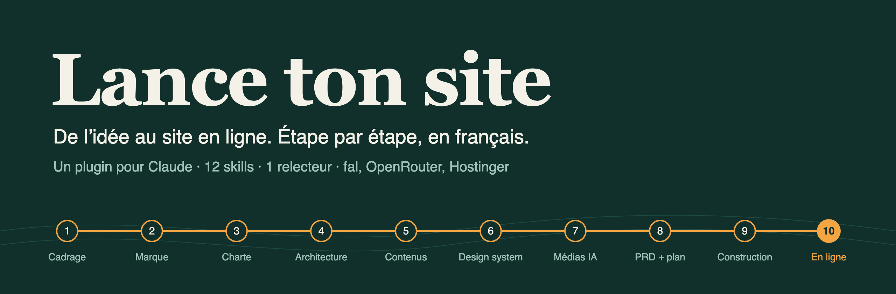

<p align="center">
  
</p>

<p align="center">
  <b>Un plugin pour Claude qui t'accompagne de l'idée jusqu'au site web en ligne.</b><br>
  Il te pose les bonnes questions, fait les recherches, écrit les documents, dessine, code et déploie.<br>
  Tu valides chaque étape.<br>
  <b>Conception dans Claude Design</b>, jusqu'à la maquette validée → <b>construction et mise en ligne dans Claude Code</b>.
</p>

<p align="center">
  <a href="#-installer-en-2-minutes">Installer</a> ·
  <a href="#%EF%B8%8F-le-parcours">Le parcours</a> ·
  <a href="#-les-commandes">Les commandes</a> ·
  <a href="#-questions-fréquentes">FAQ</a>
</p>

---

## 🤔 C'est quoi ?

Créer un bon site, ce n'est pas commencer par les couleurs. Une agence suit toujours le
même ordre : **comprendre** le client et sa cible, définir la **marque**, dessiner
l'**identité**, organiser les **pages**, écrire les **textes**, et seulement ensuite
**designer**, **coder** et **mettre en ligne**.

Lance ton site fait suivre cet ordre à Claude. Chaque étape :

1. 📖 **relit** ce qui a été décidé avant (tu ne répètes jamais deux fois la même chose) ;
2. 💬 te pose **une question à la fois**, avec des choix concrets ;
3. 🔎 **cherche** ce qui manque (avis clients, concurrents, mots-clés…) ;
4. 📄 **écrit un document** clair dans le dossier `projet-site/` ;
5. 🧐 le fait **relire** par un relecteur indépendant qui traque le flou et le « fait par IA » ;
6. ✅ attend **ton feu vert** avant de passer à la suite.

**Le niveau visé : un site d'agence à 25 000 €.** Grandes images et vidéos plein cadre,
narration au défilement façon pages produit Apple, une animation ou une interaction
dans chaque section, le tout en **Tailwind CSS v4**, **GSAP** (ScrollTrigger, SplitText)
et **Lenis**. Aucune limite de création : photos, vidéos en boucle, objets détourés,
**objets 3D**, tout est généré avec OpenRouter ou fal. Le plugin embarque un kit de
gestes prêt à l'emploi et une grille notée sur 100 : une maquette sous 90 est reprise
avant de t'être montrée.

> **Pour qui ?** Entrepreneurs, indépendants, associations, designers, formateurs —
> débutants bienvenus. Aucune connaissance technique n'est nécessaire pour les étapes 1
> à 9 : elles se font dans Claude, sans rien installer.

---

## 🗺️ Le parcours

```mermaid
flowchart LR
  subgraph D["🎨 Conception — dans Claude Design"]
    A1["1 · Cadrage<br/><i>qui, quoi, pour qui</i>"] --> A2["2 · Marque<br/><i>promesse, ton</i>"] --> A3["3 · Charte<br/><i>logo, couleurs, typos</i>"]
    A3 --> A4["4 · Architecture<br/><i>pages, parcours, SEO</i>"] --> A5["5 · Contenus<br/><i>tous les textes</i>"]
    A5 --> A6["6 · Design system<br/><i>composants</i>"] --> A7["7 · Médias IA<br/><i>photos, vidéos</i>"]
    A7 --> A8["8 · Maquette ✔<br/><i>validée par toi</i>"]
  end
  A8 -- "9 · Passation<br/><i>maquette + dossier</i>" --> A10
  subgraph C["🚀 Construction — dans Claude Code"]
    A10["10 · PRD + plan<br/><i>stack, tâches</i>"] --> A11["11 · Construction<br/><i>le code</i>"] --> A12["12 · Mise en ligne<br/><i>VPS, domaine, HTTPS</i>"]
  end
```



**Pourquoi deux lieux ?** Claude Design te montre ton site sur un canevas visuel : tu
commentes un titre, tu déplaces un bloc, tu vois le résultat tout de suite — c'est là
qu'on conçoit. Claude Code travaille dans un dossier de ton ordinateur : c'est là qu'on
code, qu'on teste et qu'on publie. **Rien n'est codé tant que la maquette n'est pas
validée.**

| # | Étape | Où | Ce que tu obtiens | Commande |
|:-:|---|---|---|---|
| 1 | **Cadrage** | Claude Design | Ton offre, ta concurrence, **tes vrais clients** : personas construits à partir de ce qu'ils disent vraiment (avis, forums), et une banque de leurs phrases exactes | `/lancetonsite:cadrage` |
| 2 | **Marque** | Claude Design | Ton positionnement, ta promesse en 10 mots, tes valeurs prouvées, ta façon de parler (« on dit / on ne dit pas ») | `/lancetonsite:marque` |
| 3 | **Charte graphique** | Claude Design | Logo (créé ou nettoyé), couleurs vérifiées, typographies gratuites, direction photo — pour tous tes supports | `/lancetonsite:charte` |
| 4 | **Architecture** | Claude Design | La liste des pages, le menu, le chemin de chaque client jusqu'à l'achat, les mots-clés Google page par page | `/lancetonsite:architecture` |
| 5 | **Contenus** | Claude Design | **Tous les textes** du site, avec les mots de tes clients, prêts pour Google et les assistants IA | `/lancetonsite:contenus` |
| 6 | **Design system** | Claude Design | Le style d'interface (choisi parmi 50), les couleurs et tailles en code, tous les boutons et blocs — et ton design system dans Claude Design | `/lancetonsite:design-system` |
| 7 | **Médias** | Claude Design | Photos et vidéos générées par IA, cohérentes comme un vrai shooting | `/lancetonsite:medias` |
| 8 | **Maquette** | Claude Design | **Toutes les pages dessinées**, desktop et mobile, avec tes vrais textes et tes vraies images ; tu commentes, on ajuste, tu valides | `/lancetonsite:maquette` |
| 9 | **Passation** | Claude Design → Claude Code | La maquette envoyée à Claude Code (« Handoff to Claude Code ») avec tout ton dossier projet | `/lancetonsite:passation` |
| 10 | **PRD + plan** | Claude Code | **Tu choisis ta techno** (Astro, WordPress, Next.js, Webflow…), puis le cahier des charges et le plan de construction | `/lancetonsite:prd` |
| 11 | **Construction** | Claude Code | Le site codé fidèlement à la maquette, testé (vitesse, accessibilité, SEO) tâche par tâche | `/lancetonsite:construire` |
| 12 | **Mise en ligne** | Claude Code | Le site en ligne sur ton VPS Hostinger : serveur sécurisé, nom de domaine relié, HTTPS | `/lancetonsite:deployer` |

Tu peux t'arrêter à n'importe quelle étape. `/lancetonsite:statut` te dit toujours où tu en es.

---

## ⚡ Installer en 2 minutes

### 1. Dans l'application Claude — pour concevoir (étapes 1 à 9)

1. **Personnaliser** → **Plugins** → **Ajouter** → **Ajouter une marketplace**
2. Coller `ohvignas/lancetonsite`
3. Installer **Lance ton site**
4. Vérifier que l'**exécution de code** est activée : **Paramètres** → **Fonctionnalités**
   (Lance ton site y range tes documents)

Puis crée un **Projet** au nom de ton site, et écris dedans :

```text
Lance ton site
```

(ou `/lancetonsite:demarrer`). Lance ton site te présente le parcours, crée ton dossier
projet et pose la première question.

### 2. Dans Claude Code — pour construire et publier (étapes 10 à 12)

Avec le même compte, le plugin ajouté dans Claude est aussi disponible dans Claude Code.
Sinon :

```text
/plugin marketplace add ohvignas/lancetonsite
/plugin install lancetonsite@lancetonsite-marketplace
```

Tu n'as rien à préparer : à l'étape 9, Lance ton site t'explique comment envoyer ta
maquette et ton dossier à Claude Code, puis quoi écrire (`/lancetonsite:prd`).

> Tu préfères tout faire dans Claude Code ? C'est possible : lance
> `/lancetonsite:demarrer` et choisis « Tout faire ici ». La maquette est alors faite en
> pages HTML au lieu du canevas Claude Design.

---

## 🧩 Prérequis

| Pour | Il faut | Installer |
|---|---|---|
| Étapes 1 à 9 | l'application Claude, exécution de code activée | — |
| Étapes 10 à 12 | [Claude Code](https://claude.com/claude-code) | voir le site de Claude Code |
| Construction (étape 11) | Node.js | [nodejs.org](https://nodejs.org) (version LTS) |
| Optimiser images et vidéos (étape 11) | ffmpeg | macOS : `brew install ffmpeg` · Ubuntu : `sudo apt install ffmpeg` |
| Tests de vitesse et d'accessibilité (étape 11) | Chrome ou Chromium | — |
| Déployer sur un VPS (étape 12) | `ssh`, `rsync` | présents sur macOS et Linux ; sous Windows, utiliser WSL |

`/lancetonsite:demarrer` vérifie ce qui manque et Lance ton site te guide au moment où l'outil
devient nécessaire. Sans lui, l'étape continue en mode dégradé et te dit ce qui n'a pas
pu être fait.

## 🔌 Les connexions (facultatives)

Le plugin embarque cinq connexions. **Aucune clé à copier** : au premier usage, une
fenêtre de connexion s'ouvre (UI Skills n'en demande même pas). Elles marchent dans
Claude comme dans Claude Code. Sans elles, Lance ton site fonctionne quand
même — il te donne alors des prompts prêts à coller.

| Service | Sert à | Quand | Coût |
|---|---|---|---|
| 🎨 **[fal](https://fal.ai)** | générer photos, vidéos, sons, logos vectoriels | étapes 3 et 7 | à l'usage (quelques centimes par image) — budget annoncé avant chaque lot |
| 🧠 **[OpenRouter](https://openrouter.ai)** | images et vidéos (Veo, Kling, Seedance…) — utilisé par défaut si fal n'est pas connecté — et second avis d'un autre modèle IA | étapes 3, 5 et 7 | à l'usage |
| 🔎 **[Firecrawl](https://www.firecrawl.dev)** | lire des sites : avis clients, concurrents, sites de référence, ton site actuel | étapes 1, 3 et refonte | offre gratuite pour démarrer, puis à l'usage |
| 🎛️ **[UI Skills](https://www.ui-skills.com)** | plus de 600 skills de design d'interface, dont **ui-ux-pro-max** et **impeccable** | étapes 6, 8 et 11 | gratuit, sans compte |
| 🖥️ **[Hostinger](https://www.hostinger.fr)** | piloter ton VPS et ton nom de domaine | étape 12 | ton abonnement VPS |

**Rien d'autre à installer.** [ui-ux-pro-max](https://github.com/nextlevelbuilder/ui-ux-pro-max-skill)
(styles, palettes, règles UX) et [impeccable](https://github.com/pbakaus/impeccable)
(critique anti-« fait par IA ») arrivent par la connexion UI Skills. Si tu les as déjà
installés sur ton ordinateur, Lance ton site utilise ta version locale.

---

## 📁 Ce que Lance ton site crée chez toi

```
ton-dossier/
├── projet-site/                 ← tous les documents, lisibles et modifiables
│   ├── 00-etat.md               ← le tableau de bord du projet
│   ├── 01-cadrage.md
│   ├── 02-marque.md
│   ├── 03-charte/               ← charte.md, planche.html, logo/
│   ├── 04-architecture.md
│   ├── 05-contenus/             ← un fichier par page
│   ├── 06-design-system/        ← DESIGN.md, tokens.css, demo.html
│   ├── 07-medias/               ← images, vidéos, manifeste
│   ├── 08-maquette/             ← maquette validée : lien, captures, export Claude Design
│   ├── 09-passation.md          ← le relais entre Claude Design et Claude Code
│   ├── 10-prd.md
│   ├── 11-plan.md
│   ├── 12-deploiement.md
│   └── sources/                 ← recherches, captures, extraits
└── site/                        ← le code du site (créé dans Claude Code)
```

Dans Claude, ce dossier vit dans l'espace d'exécution de code : Lance ton site te
propose de télécharger chaque document validé, puis tout le dossier (`projet-site.zip`)
à la passation. Dans Claude Code, il est dans le dossier de ton site.

Ce sont de simples fichiers Markdown : tu peux les lire, les corriger à la main, les
envoyer à un associé ou à un développeur. Si tu modifies un document, `/lancetonsite:statut`
te signale ce qui doit être revu derrière.

---

## 🧰 Les commandes

| Commande | Rôle |
|---|---|
| `/lancetonsite:demarrer` | Point de départ : création ou refonte, dossier projet, connexions |
| `/lancetonsite:statut` | Où j'en suis, ce qui est à revoir, la prochaine étape |
| `/lancetonsite:cadrage` | Étape 1 |
| `/lancetonsite:marque` | Étape 2 |
| `/lancetonsite:charte` | Étape 3 |
| `/lancetonsite:architecture` | Étape 4 |
| `/lancetonsite:contenus` | Étape 5 |
| `/lancetonsite:design-system` | Étape 6 |
| `/lancetonsite:medias` | Étape 7 |
| `/lancetonsite:maquette` | Étape 8 — dans Claude Design |
| `/lancetonsite:passation` | Étape 9 — envoi à Claude Code |
| `/lancetonsite:prd` | Étape 10 — dans Claude Code |
| `/lancetonsite:construire` | Étape 11 |
| `/lancetonsite:deployer` | Étape 12 — aussi `mise-a-jour` et `diagnostic` |

Pas besoin de retenir les commandes : écris simplement « je veux créer mon site »,
« trouve-moi des photos pour la page d'accueil » ou « mets le site en ligne », la bonne
étape se lance.

---

## 🛡️ Les règles que Lance ton site respecte

- **Zéro invention.** Pas de faux avis, faux chiffres, faux clients. Chaque affirmation
  porte son origine : `[source]`, `[dit par toi]` ou `[hypothèse]`.
- **Tu décides.** Les choix de goût et de techno sont présentés avec 2 ou 3 options et une
  recommandation argumentée, jamais imposés.
- **Rien de risqué sans ton « oui »** : dépense de crédits, modification du nom de domaine,
  réinstallation du serveur, publication.
- **Anti-« fait par IA ».** Un relecteur indépendant traque les textes creux (« Libérez
  votre potentiel ») et les designs génériques (dégradés violets, titre centré + 3
  cartes, emojis en icônes).
- **Accessible et rapide par défaut.** Contrastes vérifiés, navigation au clavier,
  objectifs de vitesse mesurés.
- **Pas de secret dans les documents.** Aucun mot de passe ni clé n'est écrit dans
  `projet-site/`.

---

## ❓ Questions fréquentes

<details>
<summary><b>Je ne connais rien à la technique, c'est pour moi ?</b></summary>

Oui. Les étapes 1 à 9 ne demandent que de répondre à des questions et de commenter ta
maquette. À l'étape 10, Lance ton site t'explique les options techniques en termes concrets (coût, qui
pourra modifier le site, effort) et recommande la plus simple pour ton cas.
</details>

<details>
<summary><b>À quoi ressemblera mon site ? Je ne veux pas d'un gabarit.</b></summary>

À un site d'agence, pas à une ébauche. Dès la charte, Lance ton site analyse tes
concurrents et des sites de référence (Awwwards, Godly…) pour fixer le niveau. La
maquette est en haute fidélité : grandes images (provisoires et gratuites tant que tes
photos ne sont pas là), mise en page éditoriale et **maquette animée** avec un kit de
gestes : hero épinglé, textes qui se révèlent, étapes qui défilent, galerie horizontale,
bouton magnétique, curseur… Un relecteur indépendant la note sur 100 (direction
artistique, images, mise en page, mouvement, clarté, preuves, textes, mobile). Sous 90,
elle est reprise. Le site final reprend exactement ces gestes, en restant fluide et
respectueux du réglage « réduire les animations ».
</details>

<details>
<summary><b>Pourquoi commencer dans Claude Design et pas directement dans Claude Code ?</b></summary>

Parce qu'il est bien plus simple de corriger un dessin qu'un site codé. Dans Claude
Design, tu vois chaque page, tu commentes directement (« ce bouton est trop discret »),
et tu ne valides que quand ça te plaît. Claude Code reçoit alors une maquette validée
**et** tous tes documents (textes, couleurs, SEO) : il construit ce que tu as vu, sans
deviner.
</details>

<details>
<summary><b>J'ai déjà un site. Je dois tout refaire ?</b></summary>

Non. Choisis « refonte » au démarrage : Lance ton site analyse ton site actuel, garde ce qui
marche, et prévoit les redirections pour ne pas perdre ton référencement.
</details>

<details>
<summary><b>J'ai déjà un logo et des couleurs.</b></summary>

L'étape 3 fait alors un audit (contrastes, lisibilité, déclinaisons manquantes) et propose
de garder, moderniser ou refaire — jamais de tout jeter par défaut.
</details>

<details>
<summary><b>Je veux utiliser Webflow / Framer / WordPress, pas du code.</b></summary>

Aucun problème : c'est toi qui choisis la techno à l'étape 10. Lance ton site adapte la
construction (structure et textes prêts à saisir, ou création via le connecteur de l'outil
s'il est branché) et le déploiement (publication + nom de domaine).
</details>

<details>
<summary><b>Combien ça coûte ?</b></summary>

Le plugin est gratuit et libre (MIT). Tu paies seulement ce que tu utilises : ton
abonnement Claude, les générations d'images ou vidéos (budget annoncé avant chaque lot),
et ton hébergement.
</details>

<details>
<summary><b>Et si je n'ai pas de VPS ?</b></summary>

L'étape 12 t'explique ce que c'est, ce que coûte le plus petit plan suffisant, et
propose des alternatives gratuites pour un site simple (Netlify, Cloudflare Pages,
GitHub Pages).
</details>

<details>
<summary><b>Les images générées par IA, c'est bien pour mon site ?</b></summary>

Pour l'ambiance, les textures et les fonds, oui. Pour tout ce qui doit inspirer
confiance (ton équipe, ton lieu, tes vrais produits), **tes vraies photos sont
meilleures** — Lance ton site commence toujours par te demander ce que tu as.
</details>

---

## 🧪 Exemple : MARÉE, surf shop à Biarritz

*Exemple illustratif : le projet et les chiffres sont fictifs.*

> **Toi** : je veux créer le site de mon surf shop à Biarritz
>
> **Lance ton site** : On démarre. C'est une création ou tu as déjà un site ? …
>
> *(cadrage)* J'ai lu 140 avis Google des écoles de surf de Biarritz. Ce qui revient le
> plus dans les avis à 3 étoiles : « on était 12 par moniteur » (19 mentions). Voici les
> 3 personas qui en sortent, et les 22 phrases de clients qu'on réutilisera dans tes
> textes…
>
> *(contenus)* Titre proposé : « Ton premier take-off à la Côte des Basques, à 6 élèves
> max par moniteur ». Le chiffre 6 vient de toi ; le « 12 par moniteur » chez les autres
> vient des avis.

---

## 🔒 Confidentialité

Lance ton site ne collecte aucune donnée : c'est un ensemble d'instructions et de scripts qui
s'exécutent dans ta session Claude. Tes documents restent dans ton dossier `projet-site/`
(dans ton espace Claude pendant la conception, puis sur ton ordinateur).
Quand tu utilises une connexion (fal, OpenRouter, Firecrawl, UI Skills, Hostinger), les
données nécessaires à la tâche sont envoyées à ce service, selon sa propre politique de
confidentialité : [fal](https://fal.ai/legal/privacy-policy), [OpenRouter](https://openrouter.ai/privacy),
[Firecrawl](https://www.firecrawl.dev/privacy-policy), [Hostinger](https://www.hostinger.com/fr/legal/politique-de-confidentialite).

## 🤝 Contribuer

Les idées, corrections et nouvelles recettes de déploiement sont les bienvenues :
ouvre une *issue* ou une *pull request*. Avant de proposer un changement de skill,
vérifie la structure avec :

```bash
claude plugin validate .
```

## 📜 Licence et remerciements

[MIT](LICENSE) — © 2026 ILLITH · Antoine Vigneau.

Lance ton site s'appuie sur le travail de
[Corey Haines](https://github.com/coreyhaines31/marketingskills),
[Jesse Vincent](https://github.com/obra/superpowers),
[Next Level Builder](https://github.com/nextlevelbuilder/ui-ux-pro-max-skill),
[Paul Bakaus](https://github.com/pbakaus/impeccable) et
[Hostinger](https://github.com/hostinger/api-mcp-server). Détail dans [NOTICE.md](NOTICE.md).
