<p align="center">
  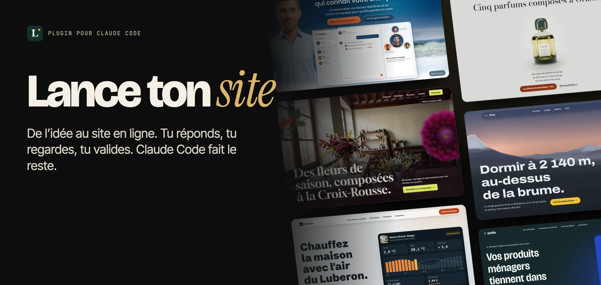
</p>

<p align="center">
  <a href="https://ohvignas.github.io/lancetonsite/docs/vitrine/index.html"></a>
  &nbsp;
  <a href="https://ohvignas.github.io/lancetonsite/docs/vitrine/elements.html#elements"></a>
</p>

<p align="center">
  <b>Exemples</b> : <a href="https://ohvignas.github.io/lancetonsite/docs/vitrine/index.html">ohvignas.github.io/lancetonsite/docs/vitrine/index.html</a><br>
  <b>Bibliothèque et prompts à copier</b> : <a href="https://ohvignas.github.io/lancetonsite/docs/vitrine/elements.html#elements">ohvignas.github.io/lancetonsite/docs/vitrine/elements.html</a>
</p>

<p align="center">
  
  
  
</p>

<p align="center">
  <a href="#installer">Installer</a> ·
  <a href="#les-exemples">Exemples</a> ·
  <a href="#la-bibliothèque">Bibliothèque</a> ·
  <a href="#le-parcours">Parcours</a> ·
  <a href="#les-connexions">Connexions</a> ·
  <a href="#questions-fréquentes">Questions</a>
</p>

<br>

| **14** | **72** | **8** | **0** |
|:--:|:--:|:--:|:--:|
| sites d'exemple | pièces prêtes à copier | compositions de page | connaissance technique demandée |

## Installer

Ouvre Claude Code dans un dossier vide au nom de ton site, puis :

```text
/plugin marketplace add ohvignas/lancetonsite
```

```text
/plugin install lancetonsite@lancetonsite-marketplace
```

```text
Lance ton site
```

C'est tout. Il présente le parcours, crée ton dossier projet et pose ses questions une seule fois.

<details>
<summary><b>Gagner du temps : le prompt à remplir pour un nouveau projet</b></summary>

Laisse vide ce que tu ne sais pas encore.

```text
Lance ton site.

Nouveau projet, rien n'existe encore.
- Nom : [nom de l'entreprise ou du projet, provisoire si besoin]
- Ville ou zone servie : [ex. Anglet, toute la France, en ligne seulement]
- Ce que je vends : [produit ou service, en une phrase]
- Prix : [ex. de 950 à 1 650 €, ou abonnement à 12,50 €]
- Mes clients : [qui ils sont, ce qu'ils cherchent]
- L'action que doit faire le visiteur : [acheter, réserver un appel, demander un devis…]
- Qui parle sur le site : [« je », « nous » ou le nom de la marque]
- Concurrents : [2 ou 3 noms ou adresses]
- Ce qui me rend différent : [avec une preuve, ex. « livré en 48 h, 12 ans de métier »]
- Sites que j'aime : [adresses], ce que je déteste : [ex. le look fluo, les photos de stock]
- Budget pour les images et vidéos générées : [ex. 5 €, 20 €, 0 €]
- Qui mettra à jour le site : [moi sans coder / moi avec l'IA / un développeur]
- Parcours : [direct, section par section / direct, tout d'un coup / dossier agence] — je valide ce que je vois
```
</details>

<details>
<summary><b>Gagner du temps : le prompt à remplir pour une refonte</b></summary>

Lance ton site lit d'abord le site actuel et tes réseaux. Il te demande tes fichiers seulement à l'étape qui en a besoin.

```text
Lance ton site.

Refonte d'un projet existant.
- Nom : [nom de l'entreprise]
- Site actuel : [adresse du site, ou « pas de site »]
- Réseaux : [Instagram, Facebook, fiche Google… avec les adresses]
- Ce que j'ai déjà : [logo, couleurs, typos, photos, avis clients, textes]
- Ce qui ne va pas aujourd'hui : [ex. trop lent, pas de demandes, fait amateur]
- Ce qu'il faut garder : [ex. le logo, le nom de domaine, les avis]
- Ce que je vends et à quel prix : [en une phrase]
- Mes clients : [qui ils sont, ce qu'ils cherchent]
- L'action que doit faire le visiteur : [acheter, réserver, demander un devis…]
- Nom de domaine : [ex. mon-site.fr, déjà acheté ou non]
- Budget pour les images et vidéos générées : [ex. 5 €, 20 €, 0 €]
- Qui mettra à jour le site : [moi sans coder / moi avec l'IA / un développeur]
- Parcours : [direct, section par section / direct, tout d'un coup / dossier agence] — je valide ce que je vois
```
</details>

<details>
<summary><b>Concevoir dans l'application Claude plutôt que dans Claude Code</b></summary>

1. **Personnaliser** → **Plugins** → **Ajouter** → **Ajouter une marketplace**
2. Coller `ohvignas/lancetonsite`
3. Installer **Lance ton site**
4. Vérifier que l'**exécution de code** est activée : **Paramètres** → **Fonctionnalités**

Crée un **Projet** au nom de ton site et écris `Lance ton site`. À l'étape 9, Lance ton site explique comment envoyer ta maquette et ton dossier à Claude Code, puis quoi écrire (`/lancetonsite:prd`). Avec le même compte, le plugin est déjà disponible dans Claude Code.
</details>

<br>

## Les exemples

Les plus récents d'abord, pour voir le plugin progresser. Clique une image pour ouvrir le vrai site. Marques fictives, sauf Kweeto.

### 6 novembre 2026 · Parcours direct

| [**Kweeto**](https://ohvignas.github.io/lancetonsite/skills/maquette/templates/exemples/agents-kweeto/index.html) · agents IA pour PME | [**Atelier Mélisse**](https://ohvignas.github.io/lancetonsite/skills/maquette/templates/exemples/fleuriste-melisse/index.html) · fleuriste à la Croix-Rousse |
|---|---|
| <a href="https://ohvignas.github.io/lancetonsite/skills/maquette/templates/exemples/agents-kweeto/index.html">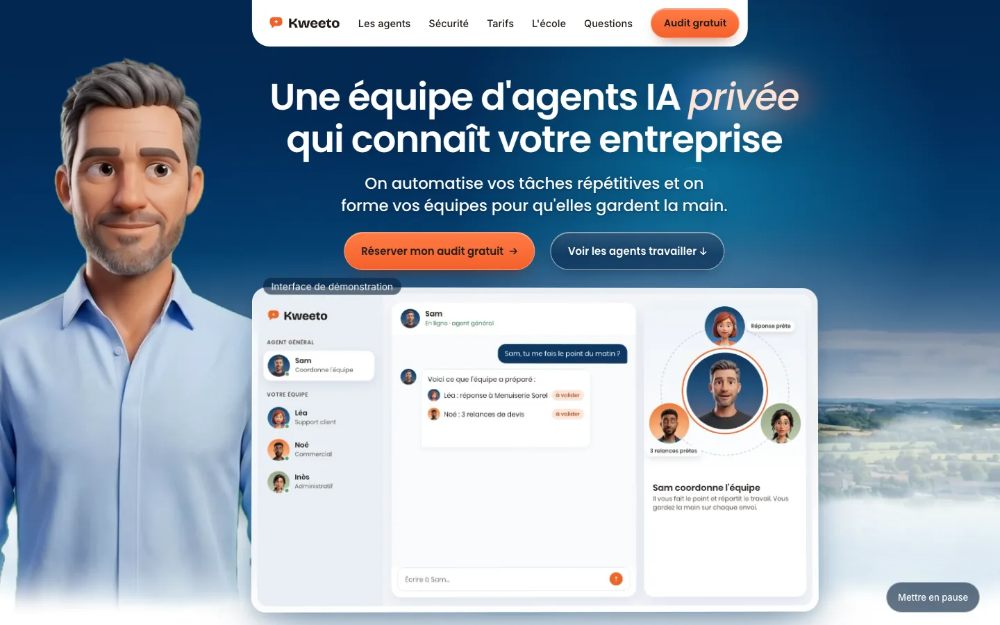</a> | <a href="https://ohvignas.github.io/lancetonsite/skills/maquette/templates/exemples/fleuriste-melisse/index.html">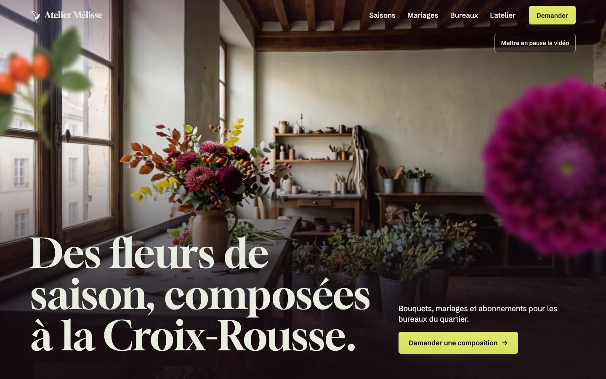</a> |
| Projet réel d'ILLITH, en maquette. Personnage vidéo dont seul l'iris suit la souris. Offres à confirmer, logos fictifs. Client simulé 70 puis 74, sous le seuil de 85 ; dernières corrections non renotées. | Fictif. Un agent, `/lancetonsite:express` seul, 25 min 30 s, environ 4,13 $ (estimé). Sans client simulé ni essai à la main. |

### 5 novembre 2026 · Autour d'un objet en 3D

| [**Ciste**](https://ohvignas.github.io/lancetonsite/skills/maquette/templates/exemples/commerce-flacon/index.html) · parfumerie à Grasse | Au défilement, rendu dans Blender |
|---|---|
| <a href="https://ohvignas.github.io/lancetonsite/skills/maquette/templates/exemples/commerce-flacon/index.html">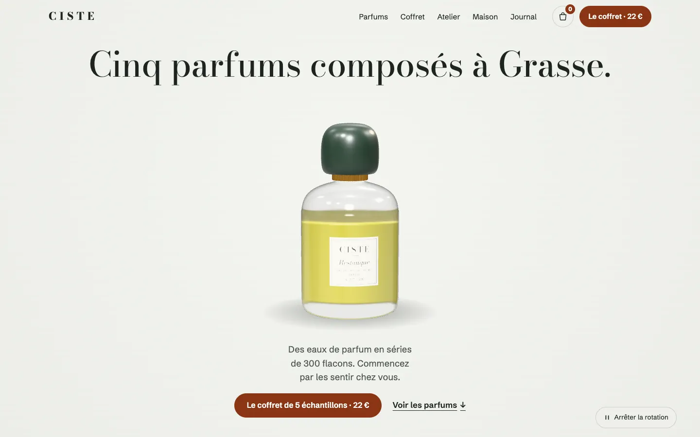</a> | 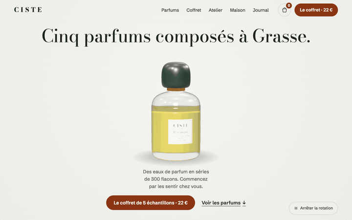 |
| Produit centré : le flacon tourne, change de parfum, se décompose en notes. Client simulé 79 → 88. | Chaque image est un rendu : verre épais, jus coloré, bague moletée, bouchon en céramique. |

| [**Refuge de la Vire**](https://ohvignas.github.io/lancetonsite/skills/maquette/templates/exemples/hebergement-cretes/index.html) · refuge à 2 140 m | [**Calorie**](https://ohvignas.github.io/lancetonsite/skills/maquette/templates/exemples/artisan-calorie/index.html) · pompes à chaleur dans le Luberon | [**Pétille**](https://ohvignas.github.io/lancetonsite/skills/maquette/templates/exemples/b2c-petille/index.html) · produits ménagers rechargeables |
|---|---|---|
| <a href="https://ohvignas.github.io/lancetonsite/skills/maquette/templates/exemples/hebergement-cretes/index.html">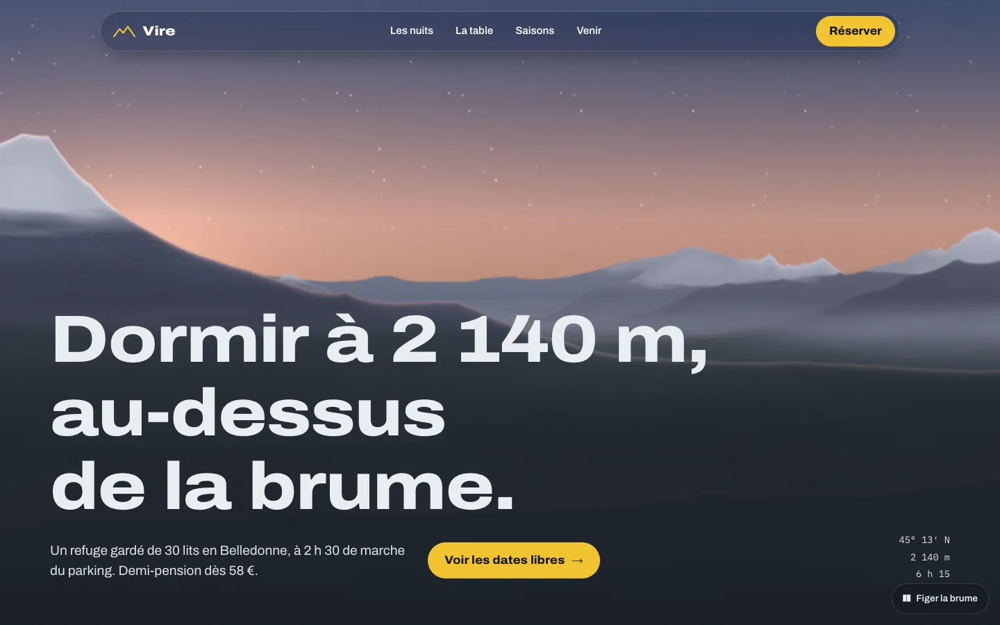</a> | <a href="https://ohvignas.github.io/lancetonsite/skills/maquette/templates/exemples/artisan-calorie/index.html">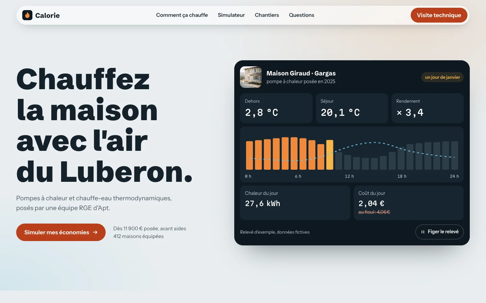</a> | <a href="https://ohvignas.github.io/lancetonsite/skills/maquette/templates/exemples/b2c-petille/index.html">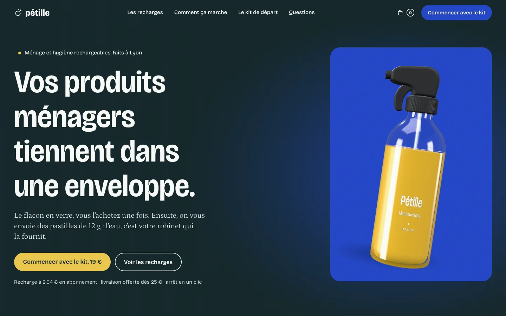</a> |
| La montagne, rendue en code, change d'heure au défilement. Client simulé 80 → 85. | Relevé vivant, maison en coupe en 3D, simulateur d'aides. Client simulé 77 → 75 → 89. | Le flacon en Three.js suit la page. 5 tours de client simulé. |

### 4 novembre 2026 · Les huit compositions

| [**Calade**](https://ohvignas.github.io/lancetonsite/skills/maquette/templates/exemples/liberal-calade/index.html) · architecte | [**Sillon**](https://ohvignas.github.io/lancetonsite/skills/maquette/templates/exemples/abonnement-sillon/index.html) · panier bio | [**Sablon**](https://ohvignas.github.io/lancetonsite/skills/maquette/templates/exemples/artisan-sablon/index.html) · céramiste | [**Miroir**](https://ohvignas.github.io/lancetonsite/skills/maquette/templates/exemples/logiciel-miroir/index.html) · logiciel |
|---|---|---|---|
| <a href="https://ohvignas.github.io/lancetonsite/skills/maquette/templates/exemples/liberal-calade/index.html">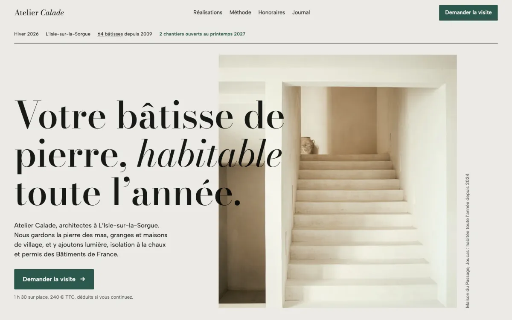</a> | <a href="https://ohvignas.github.io/lancetonsite/skills/maquette/templates/exemples/abonnement-sillon/index.html">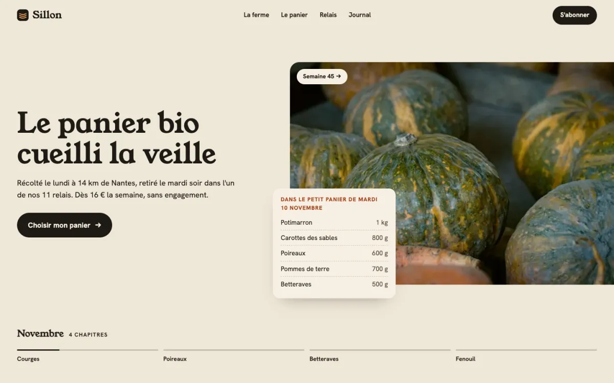</a> | <a href="https://ohvignas.github.io/lancetonsite/skills/maquette/templates/exemples/artisan-sablon/index.html">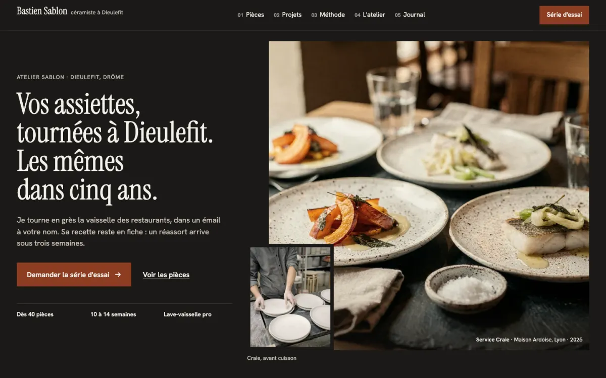</a> | <a href="https://ohvignas.github.io/lancetonsite/skills/maquette/templates/exemples/logiciel-miroir/index.html">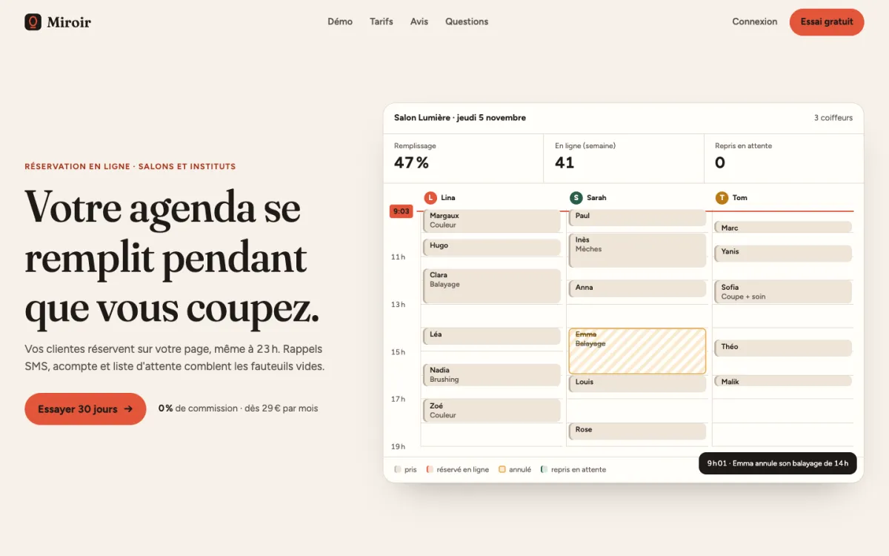</a> |
| Éditorial magazine. 73 → 88. | Récit horizontal. 67 → 87. | Galerie. 74 → 85. | Interface en démonstration. 81 → 89. |

| [**Tôle**](https://ohvignas.github.io/lancetonsite/skills/maquette/templates/exemples/festival-tole/index.html) · festival | [**Odette**](https://ohvignas.github.io/lancetonsite/skills/maquette/templates/exemples/commerce-odette/index.html) · boulangerie | [**Brume**](https://ohvignas.github.io/lancetonsite/skills/maquette/templates/exemples/b2c-brume/index.html) · torréfacteur | [**Vigie**](https://ohvignas.github.io/lancetonsite/skills/maquette/templates/exemples/b2b-vigie/index.html) · capteur industriel |
|---|---|---|---|
| <a href="https://ohvignas.github.io/lancetonsite/skills/maquette/templates/exemples/festival-tole/index.html">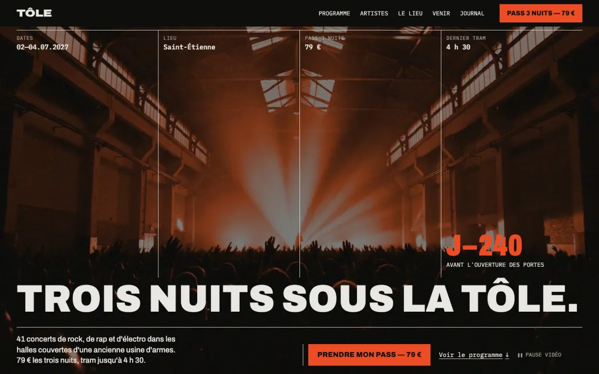</a> | <a href="https://ohvignas.github.io/lancetonsite/skills/maquette/templates/exemples/commerce-odette/index.html">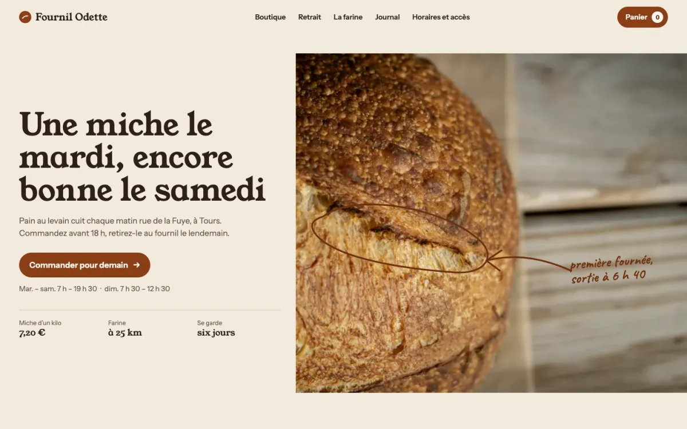</a> | <a href="https://ohvignas.github.io/lancetonsite/skills/maquette/templates/exemples/b2c-brume/index.html">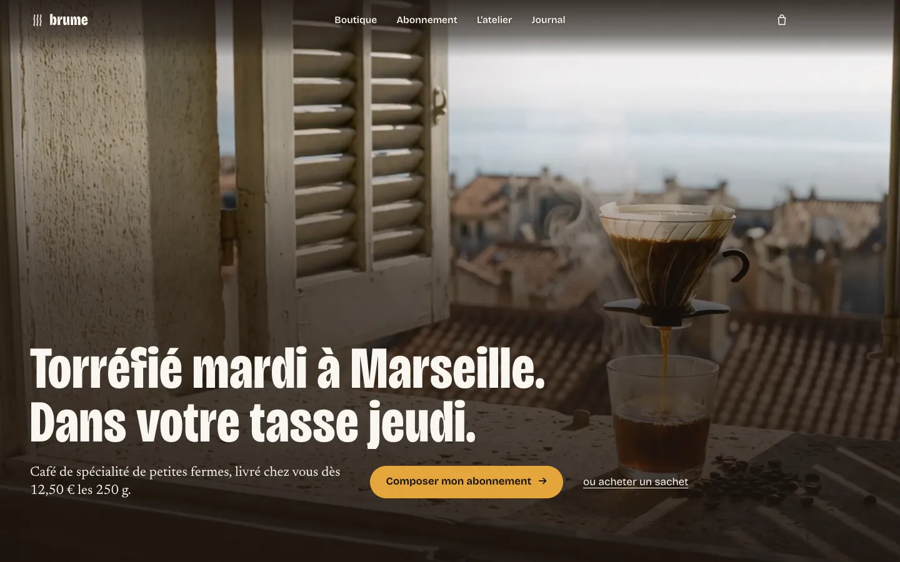</a> | <a href="https://ohvignas.github.io/lancetonsite/skills/maquette/templates/exemples/b2b-vigie/index.html">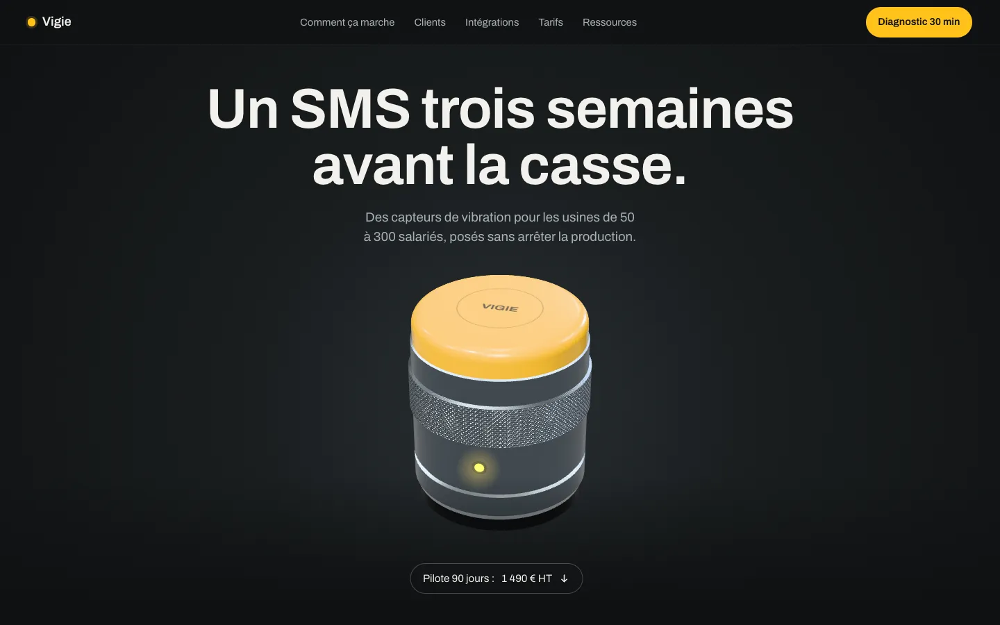</a> |
| Typographique. 66 → 77 → 88. | Carnet d'atelier. 76 → 84 → 87. | Immersif. 81 → 88. | Produit centré. 86. |

<sub>Les notes viennent d'un client joué par l'IA, jamais d'un vrai client. Les premières versions de Brume et Vigie sont gardées pour l'avant / après : <a href="skills/maquette/templates/exemples/premieres-versions/README.md"><code>premieres-versions/</code></a>. Détail de chaque exemple : <a href="skills/maquette/templates/exemples/README.md"><code>exemples/README.md</code></a>.</sub>

<br>

## La bibliothèque

Chaque pièce a sa démo, sa fiche et **son prompt à copier dans Claude Code**. Recherche, filtres et aperçu animé sur [la page de la bibliothèque](https://ohvignas.github.io/lancetonsite/docs/vitrine/elements.html#elements).

| | Contenu |
|---|---|
| **[46 éléments](skills/maquette/templates/elements/README.md)** | Verre liquide, sphère de cartes, galerie infinie, scènes de défilement, mot révélé à la souris, plugins GSAP, boutons |
| **[14 fonds de hero](skills/maquette/templates/fonds-hero/README.md)** | Shaders WebGL, canvas, CSS pur, vidéo en boucle, avec bouton pause |
| **[12 scènes 3D](skills/maquette/templates/elements-3d/README.md)** | Carte en métal, flacon en verre, île flottante, titre extrudé, avec repli sans WebGL |
| **[Outillage](skills/maquette/templates/outillage/README.md)** | Remotion, Theatre.js, RIFE + FFmpeg : licence, version, quand s'en servir |

<details>
<summary><b>Voir les planches</b></summary>

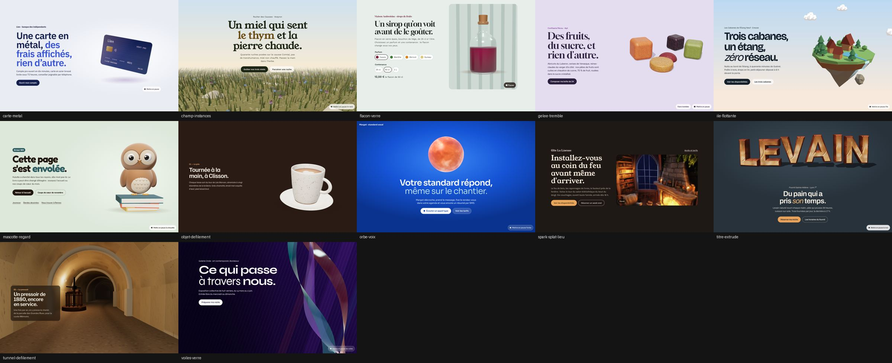

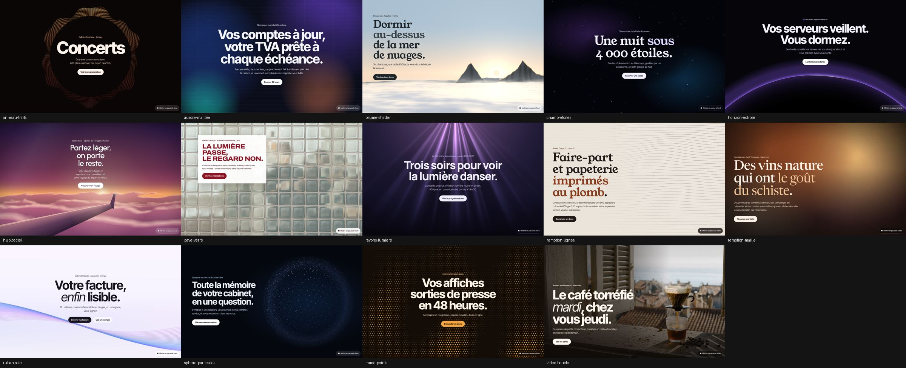

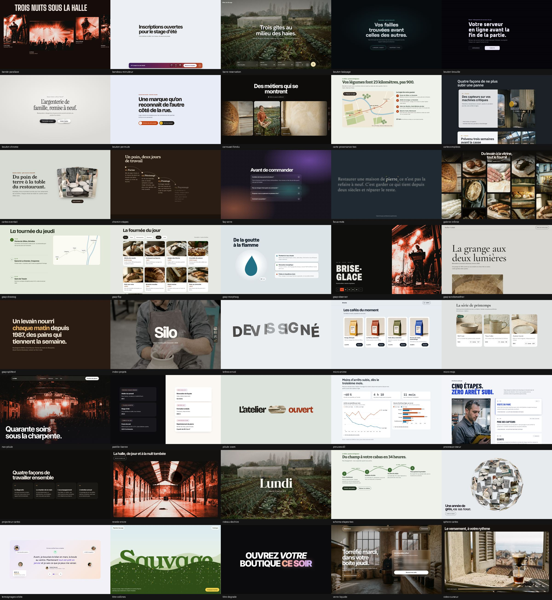
</details>

<br>

## Le parcours

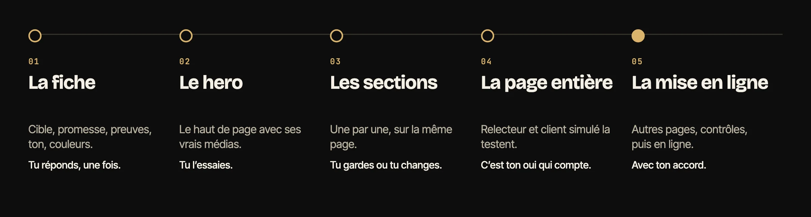

**La maquette est le site** : ce que tu valides est ce qui part en ligne.

| Commande | Pour qui | Tes validations |
|---|---|---|
| **`/lancetonsite:direct`** (par défaut) | Tu veux passer sur chaque section | La fiche, le hero, chaque section, la page, la mise en ligne |
| **`/lancetonsite:express`** | Tu veux tout d'un coup | La fiche et le site entier |
| **Dossier agence** (option au démarrage) | Ton client veut tous les documents | Chacune des 12 étapes |

<details>
<summary><b>Le dossier agence : les 12 étapes</b></summary>

Elle se choisit au démarrage, ou se rejoint depuis un projet direct avec `/lancetonsite:statut`, sans rien perdre. Chaque étape relit ce qui a été décidé, cherche ce qui manque, écrit un document, le fait relire par un relecteur indépendant et attend ton feu vert.

```mermaid
flowchart LR
  subgraph D["Conception — étapes 1 à 8"]
    A1["1 · Cadrage<br/><i>qui, quoi, pour qui</i>"] --> A2["2 · Marque<br/><i>promesse, ton</i>"] --> A3["3 · Charte<br/><i>logo, couleurs, typos</i>"]
    A3 --> A4["4 · Architecture<br/><i>pages, zoning, wireframes</i>"] --> A5["5 · Contenus<br/><i>tous les textes</i>"]
    A5 --> A6["6 · Médias<br/><i>photos, vidéos IA,<br/>objets 3D Blender</i>"] --> A7["7 · Maquette ✔<br/><i>canevas + version animée</i>"]
    A7 --> A8["8 · Design system<br/><i>tiré de la maquette validée</i>"]
  end
  A8 --> A9
  subgraph C["Construction — étapes 9 à 12"]
    A9["9 · Vérification<br/><i>tout est prêt ?</i>"] --> A10["10 · PRD + plan<br/><i>stack, tâches</i>"] --> A11["11 · Construction<br/><i>le code</i>"] --> A12["12 · Mise en ligne<br/><i>VPS, domaine, HTTPS</i>"]
  end
```

| # | Étape | Ce que tu obtiens | Commande |
|:-:|---|---|---|
| 1 | **Cadrage** | Ton offre, ta concurrence, **tes vrais clients** : personas tirés de ce qu'ils disent (avis, forums) et banque de leurs phrases exactes | `/lancetonsite:cadrage` |
| 2 | **Marque** | Positionnement, promesse en 10 mots, valeurs prouvées, façon de parler | `/lancetonsite:marque` |
| 3 | **Charte graphique** | Logo, couleurs vérifiées, typographies gratuites, direction photo, sites de référence analysés | `/lancetonsite:charte` |
| 4 | **Architecture** | Pages, menu, chemin de chaque client, mots-clés page par page, zoning et wireframes | `/lancetonsite:architecture` |
| 5 | **Contenus** | **Tous les textes**, avec les mots de tes clients | `/lancetonsite:contenus` |
| 6 | **Médias** | Photos et vidéos cohérentes comme un vrai shooting, objets 3D faits dans Blender | `/lancetonsite:medias`, `/lancetonsite:objets-3d` |
| 7 | **Maquette** | **Toutes les pages** sur un canevas Claude Design, desktop et mobile, plus une version animée | `/lancetonsite:maquette` |
| 8 | **Design system** | Tiré de la maquette : style en code, Tailwind v4, blocs et états, gestes d'animation | `/lancetonsite:design-system` |
| 9 | **Vérification** | Maquette notée, textes, médias : rien d'oublié avant de coder | `/lancetonsite:passation` |
| 10 | **PRD + plan** | **Tu choisis ta techno** (Astro, WordPress, Next.js, Webflow…), puis cahier des charges et plan | `/lancetonsite:prd` |
| 11 | **Construction** | Le site codé fidèlement, testé (vitesse, accessibilité, SEO) tâche par tâche | `/lancetonsite:construire` |
| 12 | **Mise en ligne** | Serveur sécurisé sur ton VPS Hostinger, nom de domaine relié, HTTPS | `/lancetonsite:deployer` |

Rien n'est codé tant que la maquette n'est pas validée. Si ta session n'a pas le canevas, la version animée, ses captures et tes retours suffisent.
</details>

<br>

## Ce qui fait la différence

| | |
|---|---|
| **Un client qui teste avant toi** | Un agent joue le patron qui a payé 25 000 €, puis l'acheteur de ton cadrage. Il ouvre la page dans un vrai navigateur, clique, remplit, tabule, note sur 100. Claude corrige, un nouvel agent reteste. Sur les projets de test : 71 → 83 → 88, et 85 → 93. Son « oui » reste simulé : c'est le tien qui compte. |
| **La 3D, faite dans Blender** | Gratuit, par script, sans que tu ouvres Blender. Un objet donne des photos produit, des animations au défilement et un `.glb`. Le produit du client est toujours modélisé, jamais généré par IA. [Le skill `objets-3d`](skills/objets-3d/SKILL.md). |
| **Une équipe d'agents** | Un agent par concurrent lu, par page écrite, par contrôle, tous en même temps. Les choix de direction restent à l'agent principal. |
| **Le niveau d'une agence** | Grandes images, narration au défilement, une animation par section, en Tailwind CSS v4, GSAP et Lenis. Une grille notée sur 100 : sous 85, c'est repris avant de t'être montré. |
| **Zéro invention** | Pas de faux avis, de faux chiffres ni de faux clients. Chaque affirmation porte son origine : `[source]`, `[dit par toi]` ou `[hypothèse]`. |
| **Rien de risqué sans ton oui** | Dépense de crédits, nom de domaine, réinstallation du serveur, publication. |
| **Anti « fait par IA »** | Un relecteur indépendant traque les textes creux et les designs génériques. |
| **Accessible et rapide** | Contrastes vérifiés, navigation au clavier, objectifs de vitesse mesurés. Aucun mot de passe ni clé dans tes documents. |

<br>

## Les connexions

Toutes facultatives : sans elles, Lance ton site te donne des prompts prêts à coller. **Aucune clé à copier** : une fenêtre de connexion s'ouvre au premier usage. Toutes marchent dans Claude comme dans Claude Code, sauf Blender, qui tourne sur ton ordinateur.

| Service | Sert à | Coût |
|---|---|---|
| **[fal](https://fal.ai)** | Photos, vidéos, sons, logos vectoriels | À l'usage, budget annoncé avant chaque lot |
| **[OpenRouter](https://openrouter.ai)** | Images et vidéos si fal n'est pas connecté, second avis d'un autre modèle | À l'usage |
| **[Firecrawl](https://www.firecrawl.dev)** | Lire des sites : avis, concurrents, références, ton site actuel | Offre gratuite, puis à l'usage |
| **[DataForSEO](https://dataforseo.com)** | Volumes de mots-clés, résultats Google, concurrents | À l'usage sur ton compte, coût annoncé avant chaque lot |
| **[Blender MCP](https://www.blender.org/lab/mcp-server/)** | Regarder et retoucher une scène ouverte dans Blender (serveur officiel du Blender Lab) | Gratuit ; Blender 5.1 ou plus récent avec l'accès en ligne autorisé, [uv](https://docs.astral.sh/uv/) et un module Blender, installés avec ton accord |
| **[UI Skills](https://www.ui-skills.com)** | Plus de 600 skills de design, dont [ui-ux-pro-max](https://github.com/nextlevelbuilder/ui-ux-pro-max-skill) et [impeccable](https://github.com/pbakaus/impeccable) | Gratuit, sans compte |
| **[Hostinger](https://www.hostinger.fr)** | Piloter ton VPS et ton nom de domaine | Ton abonnement ([lien partenaire](https://www.hostg.xyz/SHK4I), code **AV10** : −10 % sur le VPS) |

<br>

## Questions fréquentes

<details>
<summary><b>Je ne connais rien à la technique, c'est pour moi ?</b></summary>

Oui. Tu réponds à des questions, tu regardes, tu commentes ; Claude Code tape les commandes à ta place. Quand un choix technique se présente, il l'explique en termes concrets (coût, qui pourra modifier le site, effort) et recommande le plus simple pour ton cas.
</details>

<details>
<summary><b>À quoi ressemblera mon site ? Je ne veux pas d'un gabarit.</b></summary>

Ton site prend l'une des **huit compositions** (immersif plein écran, produit centré, éditorial magazine, typographique, récit horizontal, galerie, interface en démonstration, carnet d'atelier), choisie avec toi selon ta cible. La page d'accueil compte 10 à 13 sections, 500 à 800 mots et plus d'images que de texte. Un relecteur indépendant la note sur 100 ; sous le seuil, elle est reprise.
</details>

<details>
<summary><b>J'ai déjà un site. Je dois tout refaire ?</b></summary>

Non. Donne son adresse au démarrage : Lance ton site le reconnaît comme une refonte, l'analyse, garde ce qui marche et prévoit les redirections pour ne pas perdre ton référencement.
</details>

<details>
<summary><b>J'ai déjà un logo et des couleurs.</b></summary>

Lance ton site fait un audit (contrastes, lisibilité, déclinaisons manquantes) et propose de garder, moderniser ou refaire, jamais de tout jeter par défaut.
</details>

<details>
<summary><b>Je veux utiliser Webflow, Framer ou WordPress, pas du code.</b></summary>

C'est toi qui choisis la techno. Lance ton site adapte la construction (structure et textes prêts à saisir, ou création via le connecteur de l'outil s'il est branché) et le déploiement.
</details>

<details>
<summary><b>Combien ça coûte ?</b></summary>

Le plugin est gratuit et libre (MIT). Tu paies ton abonnement Claude, les générations d'images ou vidéos (budget annoncé avant chaque lot) et ton hébergement.
</details>

<details>
<summary><b>Et si je n'ai pas de VPS ?</b></summary>

La mise en ligne t'explique ce que c'est, ce que coûte le plus petit plan suffisant, et propose des alternatives gratuites pour un site simple (Netlify, Cloudflare Pages, GitHub Pages). Pour un VPS Hostinger : [lien partenaire](https://www.hostg.xyz/SHK4I), code **AV10** pour 10 % de réduction.
</details>

<details>
<summary><b>Les images générées par IA, c'est bien pour mon site ?</b></summary>

Pour l'ambiance, les textures et les fonds, oui. Pour ce qui doit inspirer confiance (ton équipe, ton lieu, tes vrais produits), **tes vraies photos sont meilleures** : Lance ton site commence par te demander ce que tu as.
</details>

<details>
<summary><b>Un exemple de conversation ?</b></summary>

*Exemple illustratif : le projet et les chiffres sont fictifs.*

> **Toi** : je veux créer le site de mon surf shop à Biarritz
>
> **Lance ton site** : *(cadrage)* J'ai lu 140 avis Google des écoles de surf de Biarritz. Ce qui revient le plus dans les avis à 3 étoiles : « on était 12 par moniteur » (19 mentions). Voici les 3 personas qui en sortent…
>
> *(contenus)* Titre proposé : « Ton premier take-off à la Côte des Basques, à 6 élèves max par moniteur ». Le chiffre 6 vient de toi ; le « 12 par moniteur » chez les autres vient des avis.
</details>

<br>

## Pour aller plus loin

<details>
<summary><b>Les commandes</b></summary>

Pas besoin de les retenir : écris « je veux créer mon site » ou « mets le site en ligne », la bonne étape se lance.

| Commande | Rôle |
|---|---|
| `/lancetonsite:demarrer` | Point de départ : création ou refonte, dossier projet, connexions |
| `/lancetonsite:direct` | Parcours par défaut : fiche, hero, chaque section validée, page testée, mise en ligne avec accord |
| `/lancetonsite:express` | Le même parcours d'un seul coup |
| `/lancetonsite:statut` | Où j'en suis, ce qui est à revoir, la prochaine étape |
| `/lancetonsite:cadrage` | Étape 1 |
| `/lancetonsite:marque` | Étape 2 |
| `/lancetonsite:charte` | Étape 3 |
| `/lancetonsite:architecture` | Étape 4 |
| `/lancetonsite:contenus` | Étape 5 |
| `/lancetonsite:medias` | Étape 6 |
| `/lancetonsite:objets-3d` | Objets 3D dans Blender : photos produit, animations, `.glb` (appelé par les étapes 6, 7 et 11) |
| `/lancetonsite:maquette` | Étape 7 : canevas Claude Design et version animée |
| `/lancetonsite:design-system` | Étape 8 |
| `/lancetonsite:passation` | Étape 9 : vérification avant de coder |
| `/lancetonsite:prd` | Étape 10 |
| `/lancetonsite:construire` | Étape 11 |
| `/lancetonsite:deployer` | Étape 12, aussi `mise-a-jour` et `diagnostic` |
</details>

<details>
<summary><b>Ce qu'il faut sur ton ordinateur</b></summary>

`/lancetonsite:demarrer` vérifie ce qui manque. Sans un outil, l'étape continue en mode dégradé et dit ce qui n'a pas pu être fait.

| Pour | Il faut | Installer |
|---|---|---|
| Tout le parcours | [Claude Code](https://claude.com/claude-code) | voir le site de Claude Code |
| Construction | Node.js | [nodejs.org](https://nodejs.org) (version LTS) |
| Optimiser images et vidéos | ffmpeg | macOS : `brew install ffmpeg` · Ubuntu : `sudo apt install ffmpeg` |
| Objets 3D, si le site en a | [Blender](https://www.blender.org), gratuit (testé avec la 5.2) | proposé par `/lancetonsite:objets-3d` avec ton accord (environ 1 Go) |
| Captures, tests de vitesse et d'accessibilité | Chrome ou Chromium | — |
| Déployer sur un VPS | `ssh`, `rsync` | présents sur macOS et Linux ; sous Windows, WSL |
</details>

<details>
<summary><b>Ce que Lance ton site crée chez toi</b></summary>

De simples fichiers à lire, corriger ou envoyer à un associé. Si tu modifies un document, `/lancetonsite:statut` signale ce qui doit être revu derrière. Le parcours direct ne crée que `00-etat.md`, `00-fiche.md`, `05-contenus/`, `site/` et, à la mise en ligne, `public/` et `12-deploiement.md`.

```
ton-dossier/
├── projet-site/                 ← tous les documents, lisibles et modifiables
│   ├── 00-etat.md               ← le tableau de bord du projet
│   ├── 00-fiche.md              ← parcours direct : la fiche d'une page (remplace 01 à 04)
│   ├── 01-cadrage.md
│   ├── 02-marque.md
│   ├── 03-charte/               ← charte.md, charte.html, logo/
│   ├── 04-architecture.md
│   ├── 05-contenus/             ← un fichier par page
│   ├── 06-medias/               ← images, vidéos, objets 3D (3d/), manifeste
│   ├── 07-maquette/             ← maquette validée : lien du canevas, version animée, captures
│   ├── 08-design-system/        ← DESIGN.md, tokens.css, demo.html
│   ├── 09-passation.md          ← la vérification avant de coder
│   ├── 10-prd.md
│   ├── 11-plan.md
│   ├── 12-deploiement.md
│   ├── boucle-persona/          ← les tests du client simulé : rapport, note, corrections
│   ├── sources/                 ← recherches, captures, extraits
│   └── site/                    ← le code du site
```
</details>

<details>
<summary><b>Ouvrir la vitrine chez toi</b></summary>

Les scènes 3D ont besoin d'un petit serveur. À la racine du dépôt :

```bash
python3 -m http.server
```

Puis ouvre http://localhost:8000/docs/vitrine/index.html.
</details>

## Confidentialité

Lance ton site ne collecte aucune donnée : ce sont des instructions et des scripts qui s'exécutent dans ta session Claude. Tes documents restent dans ton dossier `projet-site/`. Quand tu utilises une connexion, les données nécessaires à la tâche sont envoyées à ce service, selon sa politique : [fal](https://fal.ai/legal/privacy-policy), [OpenRouter](https://openrouter.ai/privacy), [Firecrawl](https://www.firecrawl.dev/privacy-policy), [DataForSEO](https://dataforseo.com/privacy-policy), [Hostinger](https://www.hostinger.com/fr/legal/politique-de-confidentialite).

## Contribuer

Idées, corrections et recettes de déploiement sont les bienvenues : ouvre une *issue* ou une *pull request*. Avant de proposer un changement de skill :

```bash
claude plugin validate .
```

## Licence

[MIT](LICENSE) · © 2026 ILLITH · Antoine Vigneau.

S'appuie sur le travail de [Corey Haines](https://github.com/coreyhaines31/marketingskills), [Jesse Vincent](https://github.com/obra/superpowers), [Next Level Builder](https://github.com/nextlevelbuilder/ui-ux-pro-max-skill), [Paul Bakaus](https://github.com/pbakaus/impeccable) et [Hostinger](https://github.com/hostinger/api-mcp-server). Détail dans [NOTICE.md](NOTICE.md).
