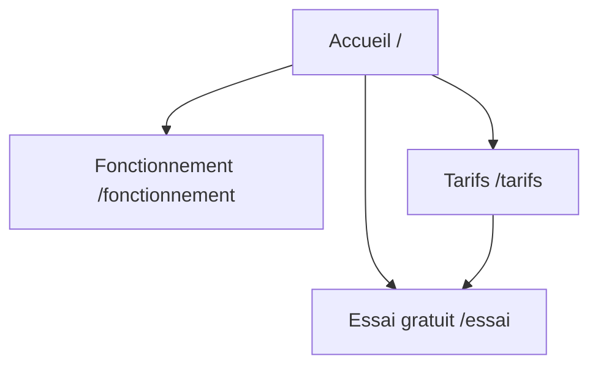

# Modèle : architecture du site

> Livrable : `projet-site/04-architecture.md`, `04-wireframes/` · Étape 4

## À quoi il sert

Il dit quelles pages existent, comment on passe de l'une à l'autre, ce que chaque page
doit faire faire au visiteur, et dans quel ordre les blocs s'y empilent. L'architecture
de l'information n'est pas un seul schéma : c'est un plan du site, des parcours, un
plan SEO et des zonings. Le patron y vérifie que son client trouve ce qu'il cherche en
deux clics et arrive toujours à l'action principale.

Lecteur : le patron (le plan et les parcours) ; Claude aux étapes 5 à 8 (le zoning).

## Sommaire type

| # | Section | Contenu exact | Longueur | Forme |
|---|---|---|---|---|
| 1 | Plan du site | Toutes les pages V1, hiérarchie, URL de chacune | 6 à 15 nœuds | Schéma Mermaid `flowchart` + tableau page / URL |
| 2 | Navigation | Menu principal (5 entrées au plus), menu de pied de page, bouton d'action permanent | 6 lignes | Liste |
| 3 | Parcours | Par profil cible : point d'entrée, étapes, objections levées en route, action finale | 1 schéma par profil | Mermaid `flowchart LR` |
| 4 | SEO par page | Requête principale, intention (info, comparaison, achat), requêtes secondaires, volume, questions à traiter, title visé | 1 ligne par page | Tableau |
| 5 | Liens internes | Plan complet : quelle page renvoie vers quelle autre, et avec quel texte de lien ; aucune page orpheline | Au moins 1 ligne par page | Tableau source / cible / ancre |
| 6 | Zoning par page | Les blocs dans l'ordre, chacun avec son rôle (accrocher, prouver, rassurer, faire agir), la question traitée, le message, la preuve, l'image et l'action | 6 à 10 blocs par page | Tableau ordonné |
| 7 | Gabarits | Types de pages réutilisables (accueil, offre, article, contact) ; chacun a son zoning et son wireframe | 3 à 5 lignes | Liste |
| 8 | Inventaire de contenus | Ce qui existe déjà et ce qu'il faut produire (textes, photos, avis, chiffres), pour chaque page | 1 ligne par contenu | Tableau page / contenu / existe ? / qui le fournit / pour quand |
| 9 | Wireframes | Chaque page et chaque gabarit en blocs gris légendés, ordinateur et téléphone, d'après son zoning | 1 fichier par page | HTML dans `04-wireframes/`, relié depuis le document ; captures à 1440 et 375 px dans `04-wireframes/captures/` pour le contrôle |

### Détails qui comptent

- **Plan du site** en Mermaid, lisible tel quel dans un artifact :

- **Zoning** : un tableau par page, ordre de défilement, sans dessin.

| # | Bloc | Rôle | Question du persona traitée | Message | Preuve | Image | Action |
|---|---|---|---|---|---|---|---|
| 1 | Hero | Accrocher | Qu'est-ce que c'est, pour qui ? | Promesse, sous-titre | — | Plein cadre | Bouton principal |
| 2 | Preuve rapide | Rassurer | Pourquoi vous croire ? | Ce que prouvent les chiffres | 3 chiffres ou logos clients | — | — |

- **Mobile** : préciser ce qui change d'ordre ou disparaît sur téléphone.
- **SEO** : une seule requête principale par page ; deux pages ne visent jamais la même.
  Le volume est un chiffre seulement si un outil de volumes connecté l'a donné ; sinon
  « fort / moyen / faible », avec la mention « estimé ».
- **Parcours** : un par profil cible, sans en laisser de côté.
- **Périmètre « accueil seul »** (`00-etat.md`) : le plan du site ne compte que l'accueil
  et les pages légales ; le contenu des pages dédiées reste sur l'accueil.

## Ce qui le rend « niveau agence »

1. Chaque page a une URL, une requête principale distincte et une action attendue.
2. Chaque profil cible a un parcours écrit qui finit sur l'action principale en 3 clics
   au plus.
3. Le zoning donne un rôle à chaque bloc ; aucun bloc « présentation » sans fonction.
   Chaque page et chaque gabarit a son zoning et son wireframe.
4. L'inventaire dit qui fournit chaque contenu manquant et pour quand.
5. Le menu principal a 5 entrées au plus, nommées avec les mots du client (pas
   « Solutions », « Services »).

## Comment le publier

La source est `projet-site/04-architecture.md`, écrite depuis
`skills/architecture/templates/04-architecture.md`. Markdown en artifact Docs ; les schémas
Mermaid s'affichent dans l'artifact. Les **wireframes** de chaque page (`04-wireframes/`, blocs gris légendés, ordinateur et
téléphone) sont publiés avec lui : l'index en artifact, relié depuis le document. Pas de
couleur ni de police de la charte dans un wireframe : la maquette les apporte. Les captures
servent au contrôle ; elles ne remplacent jamais les wireframes dans le document.

## Sources consultées

- Nielsen Norman Group, architecture de l'information et plan du site :
  https://www.nngroup.com/articles/information-architecture-sitemaps/
- Adobe, panorama des livrables UX (plan, parcours, wireframes annotés) :
  https://blog.adobe.com/en/publish/2017/09/26/a-comprehensive-overview-of-ux-design-deliverables
- AltexSoft, architecture de l'information pas à pas :
  https://www.altexsoft.com/blog/information-architecture/
