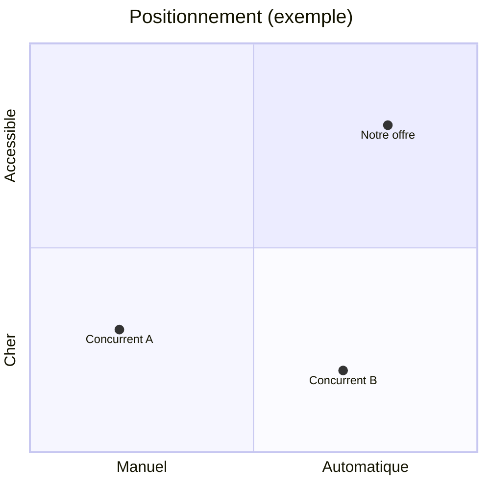

# Modèle : cadrage (brief et étude des concurrents)

> Livrable : `projet-site/01-cadrage.md` · Étape 1 · Version courte : 6 min visées

## À quoi il sert

C'est le brief d'agence : la page que le patron relit pour dire « oui, c'est bien mon
entreprise, mon client, mon problème ». Toutes les étapes suivantes s'y réfèrent, donc
chaque affirmation doit y être vérifiable : un chiffre, une citation, une URL de
concurrent. Si un fait manque, on écrit une hypothèse marquée `[H]` au lieu de bloquer.

Lecteur : le patron, en 3 minutes (visé). Il ne lit pas de jargon (« persona », « USP ») sans
explication d'une ligne.

## Sommaire type

| # | Section | Contenu exact | Longueur | Forme |
|---|---|---|---|---|
| 1 | Le projet en une phrase | Qui, quoi, pour qui, pourquoi maintenant | 1 phrase | Citation en exergue |
| 2 | Objectifs et mesure | 1 objectif principal, 2 secondaires, chacun avec un indicateur chiffré et une échéance | 3 lignes | Tableau objectif / indicateur / cible / date |
| 3 | L'offre | Produits ou services, prix, ce qui est vendu en ligne ou non | 5 à 8 lignes | Tableau offre / prix / canal |
| 4 | Le client cible | 1 à 2 profils : situation, problème, déclencheur d'achat, objections, mots qu'il emploie | 8 à 12 lignes par profil | Fiche (liste à puces) + 2 citations réelles ou `[H]` |
| 5 | Concurrence | 4 à 5 concurrents : promesse, prix, preuve, action principale, point fort, point faible | 1 ligne par critère | Tableau comparatif (concurrents en colonnes) |
| 6 | Les leaders du secteur | Ce que le meilleur fait mieux que tous (structure, preuve, tunnel) | 3 à 5 puces | Liste + URL |
| 7 | L'angle libre | Ce qu'aucun concurrent ne dit et que l'entreprise peut prouver | 2 à 3 lignes | Encadré |
| 8 | Périmètre V1 | Pages et fonctions indispensables, options, hors périmètre | 10 lignes | 3 listes : V1 / plus tard / exclu |
| 9 | Contraintes | Budget, date, qui maintiendra le site, outils existants, légal (RGPD, mentions) | 5 lignes | Tableau |
| 10 | Hypothèses et questions ouvertes | Tout ce qui est `[H]`, avec qui peut le confirmer | 3 à 8 lignes | Liste numérotée |

Total : 1,5 à 3 pages d'écran.

### Détails qui comptent

- **Objectifs** : « plus de visibilité » est refusé. On écrit « 20 demandes d'essai par
  mois d'ici mars », même si le chiffre est une hypothèse `[H]`.
- **Concurrence** : relever pour chacun le titre du hero mot pour mot, le prix affiché
  (ou « non affiché »), la preuve principale (avis, chiffres, logos), le bouton principal.
  Sources : page d'accueil, page tarifs, page produit. Garder les captures dans `sources/`.
- **Matrice de messages** (dans le tableau concurrents) : promesse, cible visée, élément
  différenciant, ton. C'est elle qui nourrit la plateforme de marque.
- **Carte de positionnement** facultative : un schéma Mermaid `quadrantChart` sur deux axes
  qui comptent pour l'acheteur (par exemple prix et automatisation).



## Ce qui le rend « niveau agence »

1. Chaque objectif a un indicateur chiffré et une date.
2. Le tableau des concurrents cite leurs vrais titres et prix, avec l'URL de chaque source.
3. Le client cible parle avec ses mots : au moins 2 citations (avis Google, forum,
   entretien), ou des hypothèses `[H]` déclarées comme telles.
4. Un hors-périmètre explicite existe (au moins 3 éléments exclus de la V1).
5. Aucune phrase ne pourrait s'appliquer telle quelle à un concurrent (test : remplacer le
   nom de l'entreprise par celui d'un concurrent ; si la phrase reste vraie, la réécrire).

## Version courte (par défaut)

Temps visé : 6 min. Elle part du questionnaire groupé du démarrage (une seule série de
questions) et lance en parallèle l'extraction des 4 concurrents.

- **On garde** : sections 1, 2, 4 (un seul profil), 5 (4 concurrents, 4 critères :
  promesse, prix, preuve, action), 7, 8, 10.
- **On reporte** : leaders du secteur, carte de positionnement, deuxième profil,
  contraintes détaillées (une ligne suffit).

Squelette à remplir :

```markdown
# Cadrage — {Nom}
> Étape 1 — mis à jour le JJ/MM/AAAA — statut : brouillon

> {Nom} aide {cible} à {résultat} grâce à {moyen}, parce que {déclencheur}.

## Objectifs
| Objectif | Indicateur | Cible | Échéance |
|---|---|---|---|

## Le client cible
- Situation :
- Problème qui coûte :
- Déclencheur d'achat :
- Objections :
- Ses mots : « … » (source)

## Concurrence
| | Concurrent A | Concurrent B | Concurrent C | Concurrent D |
|---|---|---|---|---|
| Promesse (titre du hero) | | | | |
| Prix affiché | | | | |
| Preuve principale | | | | |
| Action principale | | | | |

## L'angle libre
## Périmètre V1
- V1 :
- Plus tard :
- Exclu :
## Hypothèses à confirmer
1. [H] …
```

## Comment le publier

Markdown seul, lisible tel quel dans un artifact Docs. Tableaux Markdown standard, une
citation en exergue, aucun visuel généré. Le schéma Mermaid est facultatif.

## Sources consultées

- ImagesCréations, modèle de cahier des charges en 12 rubriques et erreurs fréquentes :
  https://www.imagescreations.fr/cahier-des-charges-site-internet/
- WebCrew, modèle de cahier des charges et exemple de refonte :
  https://webcrew.agency/ressources/cahier-des-charges-site-internet
- Rework, grille d'analyse concurrentielle :
  https://resources.rework.com/libraries/strategic-management/competitive-analysis
- Kompyte, analyse des messages et du positionnement :
  https://www.kompyte.com/blog/messaging-positioning-analysis/
