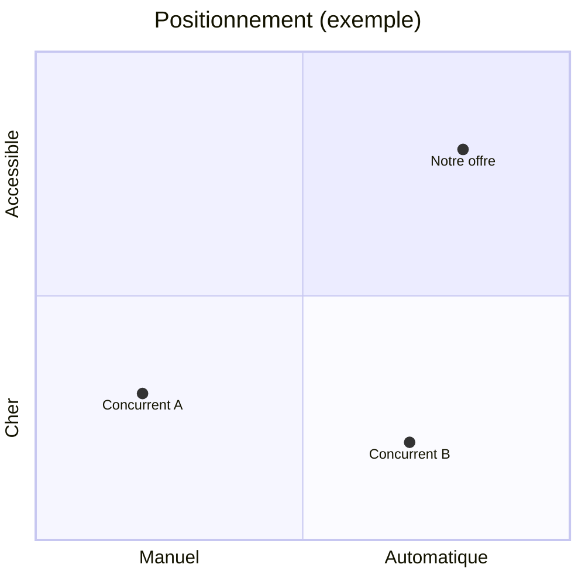

# Modèle : cadrage (brief et étude des concurrents)

> Livrable : `projet-site/01-cadrage.md` · Étape 1 · Version courte : 6 min visées

## À quoi il sert

C'est le brief d'agence : la page que le patron relit pour dire « oui, c'est bien mon
entreprise, mon client, mon problème ». Toutes les étapes suivantes s'y réfèrent, donc
chaque affirmation doit y être vérifiable : un chiffre, une citation, une URL de
concurrent. Si un fait manque, on écrit une hypothèse marquée `[hypothèse]` au lieu de
bloquer. La banque de citations et le tableau des leaders y sont lus par l'architecture,
la charte et les contenus : ils ne sont jamais retirés.

Lecteur : le patron, en 3 minutes (visé). Il ne lit pas de jargon (« persona », « USP ») sans
explication d'une ligne.

## Sommaire type

Les sections suivent `skills/cadrage/templates/01-cadrage.md`, titre pour titre.

| # | Section | Contenu exact | Longueur | Forme |
|---|---|---|---|---|
| 1 | Le projet en 3 lignes | Qui, quoi, pour qui, ce qui le rend différent | 3 lignes au plus | Citation en exergue |
| 2 | L'offre | Produits ou services, prix, saison, ce qui est vendu en ligne ou non | 5 à 8 lignes | Tableau offre / prix / pour qui / saison |
| 3 | L'objectif du site | Action principale, actions secondaires, succès dans 6 mois avec un indicateur chiffré | 3 lignes | Liste |
| 4 | La cible | Segments, 1 à 3 personas (situation, problème, déclencheur d'achat, objections, mots employés), anti-persona | 8 à 12 lignes par persona | Fiche + tableau des segments |
| 5 | Banque de citations | Phrases réelles de la cible, classées par thème | 10 à 15 en version courte, 15 à 25 sur demande | Liste par thème, chaque citation avec sa source |
| 6 | Concurrence | 3 à 5 concurrents : offre, prix, promesse, ce qu'ils font bien, ce que leurs clients leur reprochent, l'ouverture pour nous | 1 page au plus | Tableau comparatif |
| 6 (suite) | Les leaders du secteur | 2 au plus : ce qu'ils font de mieux, ce qu'on reprend, comment on fait mieux | 2 à 5 lignes | Tableau + URL |
| 7 | La différence | Ce qu'aucun concurrent ne dit et que l'entreprise peut prouver | 2 à 3 lignes | Encadré |
| 8 | Ce que la marque n'est pas | Ce qu'elle refuse d'être | 3 puces | Liste |
| 9 | L'existant | Logo, couleurs, photos, avis, chiffres réels : disponible ou non, et où | 5 lignes | Tableau |
| 10 | Contraintes et périmètre | Budget du projet, date, qui maintiendra le site, légal (RGPD, mentions), et au moins 3 éléments exclus de la V1 | 5 lignes | Tableau |
| 11 | Hypothèses à vérifier | Tout ce qui est `[hypothèse]`, avec comment le vérifier | 3 à 8 lignes | Tableau |

Total : 1,5 à 3 pages d'écran.

### Détails qui comptent

- **Objectifs** : « plus de visibilité » est refusé. On écrit « 20 demandes d'essai par
  mois d'ici mars », même si le chiffre est une `[hypothèse]`.
- **Concurrence** : relever pour chacun le titre du hero mot pour mot, le prix affiché
  (ou « non affiché »), la preuve principale (avis, chiffres, logos), le bouton principal.
  Sources : page d'accueil, page tarifs, page produit. Garder les captures dans `sources/`.
- **Matrice de messages** (dans le tableau concurrents) : promesse, cible visée, élément
  différenciant, ton. C'est elle qui nourrit la plateforme de marque.
- **Carte de positionnement** facultative : un schéma Mermaid `quadrantChart` sur deux axes
  qui comptent pour l'acheteur (par exemple prix et automatisation).



## Ce qui le rend « niveau agence »

1. Chaque objectif a un indicateur chiffré et une date.
2. Le tableau des concurrents cite leurs vrais titres et prix, avec l'URL de chaque source.
3. Le client cible parle avec ses mots : la banque de citations tient au moins 10 phrases
   réelles avec leur source, ou les manques sont déclarés `[hypothèse]`.
4. Un hors-périmètre explicite existe (au moins 3 éléments exclus de la V1).
5. Aucune phrase ne pourrait s'appliquer telle quelle à un concurrent (test : remplacer le
   nom de l'entreprise par celui d'un concurrent ; si la phrase reste vraie, la réécrire).

## Version courte (par défaut)

Temps visé : 6 min. Elle part du questionnaire groupé du démarrage (une seule série de
questions) et lance en parallèle les agents `chercheur` : un par concurrent, un pour les
avis clients, un pour le marché, un pour les mots-clés.

- **On garde** : toutes les sections, au format court : 3 à 5 concurrents (promesse, prix,
  preuve, action, ouverture), les leaders (2 au plus), 10 à 15 citations, 1 à 3 personas
  (un seul si les sources manquent), contraintes en une ligne.
- **On reporte, sur demande** : la carte de positionnement, 15 à 25 citations, les
  contraintes détaillées.

Squelette à remplir :

```markdown
# Cadrage — {Nom}
> Étape 1 — mis à jour le JJ/MM/AAAA — statut : brouillon

> {Nom} aide {cible} à {résultat} grâce à {moyen}, parce que {déclencheur}.

## Objectifs
| Objectif | Indicateur | Cible | Échéance |
|---|---|---|---|

## La cible
- Situation :
- Problème qui coûte :
- Déclencheur d'achat :
- Objections :
- Ses mots : « … » (source)

## Banque de citations
- Thème : « … » (source)

## Concurrence
| | Concurrent A | Concurrent B | Concurrent C | (D, E) |
|---|---|---|---|---|
| Promesse (titre du hero) | | | | |
| Prix affiché | | | | |
| Preuve principale | | | | |
| Action principale | | | | |
| L'ouverture pour nous | | | | |

## Les leaders du secteur
| Leader | Ce qu'il fait de mieux | Ce qu'on reprend |
|---|---|---|

## La différence
## Contraintes et périmètre
- Contraintes :
- Exclu de la V1 :
## Hypothèses à vérifier
1. [hypothèse] …
```

## Comment le publier

Markdown seul, lisible tel quel dans un artifact Docs. Tableaux Markdown standard, une
citation en exergue, aucun visuel généré. Le schéma Mermaid est facultatif.

## Sources consultées

- ImagesCréations, modèle de cahier des charges en 12 rubriques et erreurs fréquentes :
  https://www.imagescreations.fr/cahier-des-charges-site-internet/
- WebCrew, modèle de cahier des charges et exemple de refonte :
  https://webcrew.agency/ressources/cahier-des-charges-site-internet
- Rework, grille d'analyse concurrentielle :
  https://resources.rework.com/libraries/strategic-management/competitive-analysis
- Kompyte, analyse des messages et du positionnement :
  https://www.kompyte.com/blog/messaging-positioning-analysis/
