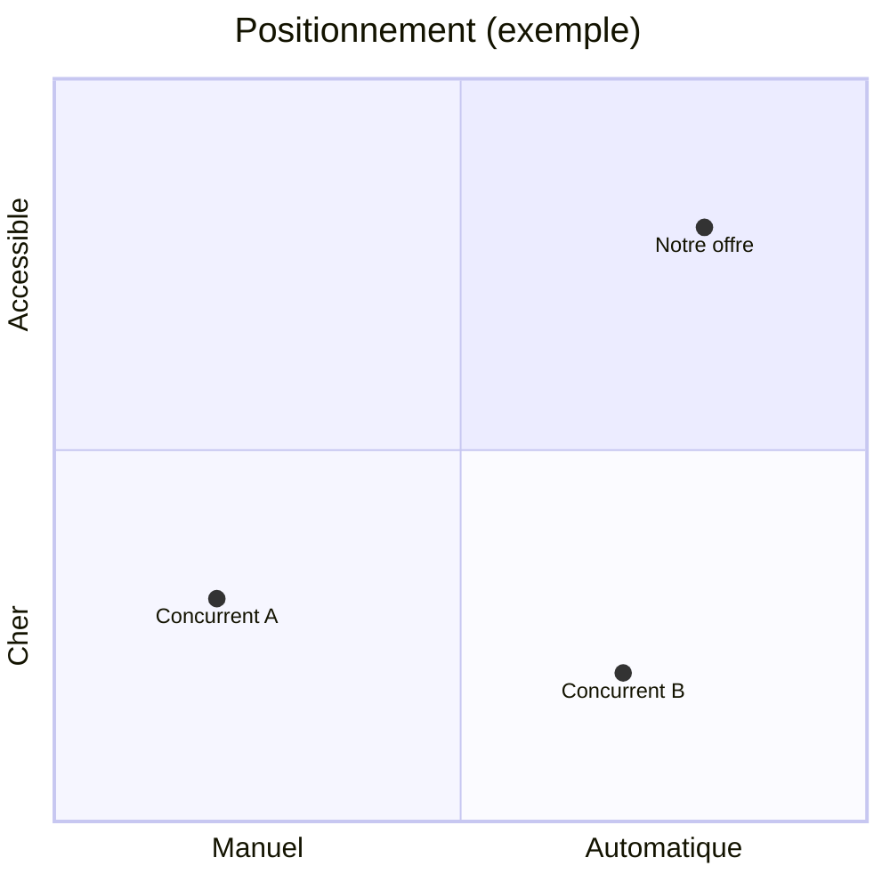

# Modèle : cadrage (brief et étude des concurrents)

> Livrable : `projet-site/01-cadrage.md` · Étape 1

## À quoi il sert

C'est le brief d'agence : la page que le patron relit pour dire « oui, c'est bien mon
entreprise, mon client, mon problème ». Toutes les étapes suivantes s'y réfèrent, donc
chaque affirmation doit y être vérifiable : un chiffre, une citation, une URL de
concurrent. Si un fait manque, on écrit une hypothèse marquée `[hypothèse]` au lieu de
bloquer. La banque de citations et le tableau des leaders y sont lus par l'architecture,
la charte et les contenus.

Lecteur : le patron. Il ne lit pas de jargon (« persona », « USP ») sans explication d'une
ligne.

## Comment il se prépare

Il part du questionnaire groupé du démarrage (une seule série de questions) et lance en
parallèle les agents `chercheur` : un par concurrent, un pour les avis clients, un pour le
marché, un pour les mots-clés. Aucune nouvelle question en cours d'étape.

## Sommaire type

Les sections suivent `skills/cadrage/templates/01-cadrage.md`, titre pour titre. Toutes
sont obligatoires.

| # | Section | Contenu exact | Longueur | Forme |
|---|---|---|---|---|
| 1 | Le projet en 3 lignes | Qui, quoi, pour qui, ce qui le rend différent | 3 lignes au plus | Citation en exergue |
| 2 | L'offre | Produits ou services, prix, saison, ce qui est vendu en ligne ou non | Une ligne par produit ou service | Tableau offre / prix / pour qui / saison / vendu en ligne |
| 3 | L'objectif du site | Action principale, actions secondaires, succès dans 6 mois avec un indicateur chiffré | 2 lignes et le tableau | Liste, puis tableau objectif / indicateur / cible / échéance |
| 4 | La cible | Segments, 1 à 3 personas (situation, jobs, douleurs, déclencheurs, résultat espéré, objections, alternatives, canaux, mots employés, mots à éviter, sources), anti-persona | 8 à 12 lignes par persona | Fiche + tableau des segments |
| 5 | Banque de citations | Phrases réelles de la cible, classées par thème | 15 à 25 citations | Liste par thème, chaque citation avec sa source |
| 6 | Concurrence | 3 à 5 concurrents : offre, prix, promesse, cible, différence, ton, preuve, action, ce qu'ils font bien, ce que leurs clients leur reprochent, l'ouverture pour nous, URL | Une colonne par concurrent | Tableau comparatif |
| 6 (suite) | Les leaders du secteur | 2 leaders : ce qu'ils font de mieux, ce qu'on reprend, comment on fait mieux | 2 lignes | Tableau + URL |
| 6 (suite) | Carte de positionnement | Les concurrents et l'offre sur deux axes qui comptent pour l'acheteur, puis la ligne « l'ouverture » | Un schéma | Mermaid `quadrantChart` |
| 7 | La différence | Ce qu'aucun concurrent ne dit et que l'entreprise peut prouver | 2 à 3 lignes | Encadré |
| 8 | Ce que la marque n'est pas | Ce qu'elle refuse d'être | 3 puces | Liste |
| 9 | L'existant | Logo, couleurs, photos, textes, avis, chiffres réels : disponible ou non, et où | Une ligne par élément | Tableau |
| 10 | Contraintes et périmètre | Budget du projet, date, qui maintiendra le site, langues, légal (RGPD, mentions, secteur), et au moins 3 éléments exclus de la V1 | Une ligne par contrainte | Tableau |
| 11 | Hypothèses à vérifier | Tout ce qui est `[hypothèse]`, avec comment le vérifier | Une ligne par hypothèse | Tableau |

### Détails qui comptent

- **Objectifs** : « plus de visibilité » est refusé. On écrit « 20 demandes d'essai par
  mois d'ici mars », même si le chiffre est une `[hypothèse]`.
- **Concurrence** : relever pour chacun le titre du hero mot pour mot, le prix affiché
  (ou « non affiché »), la preuve principale (avis, chiffres, logos), le bouton principal.
  Sources : pages d'offre, de prix, de preuve, de FAQ et « à propos », avis clients.
  Fichiers dans `sources/concurrents/`, avec la capture de l'accueil quand l'outil en donne une.
- **Matrice de messages** (dans le tableau concurrents) : promesse, cible visée, élément
  différenciant, ton. C'est elle qui nourrit la plateforme de marque.
- **Carte de positionnement** : un schéma Mermaid `quadrantChart` sur deux axes qui
  comptent pour l'acheteur (par exemple prix et automatisation).

## Ce qui le rend « niveau agence »

1. Chaque objectif a un indicateur chiffré et une date.
2. Le tableau des concurrents cite leurs vrais titres et prix, avec l'URL de chaque source.
3. Le client cible parle avec ses mots : la banque de citations tient au moins 15 phrases
   réelles avec leur source, ou les manques sont déclarés `[hypothèse]`.
4. Un hors-périmètre explicite existe (au moins 3 éléments exclus de la V1).
5. Aucune phrase ne pourrait s'appliquer telle quelle à un concurrent (test : remplacer le
   nom de l'entreprise par celui d'un concurrent ; si la phrase reste vraie, la réécrire).

## Comment le publier

Markdown lisible tel quel dans un artifact Docs. Tableaux Markdown standard, une citation
en exergue, aucun visuel généré. La carte de positionnement est publiée avec le document :
si le document n'affiche pas Mermaid, la redessiner en schéma SVG.

## Sources consultées

- ImagesCréations, modèle de cahier des charges en 12 rubriques et erreurs fréquentes :
  https://www.imagescreations.fr/cahier-des-charges-site-internet/
- WebCrew, modèle de cahier des charges et exemple de refonte :
  https://webcrew.agency/ressources/cahier-des-charges-site-internet
- Rework, grille d'analyse concurrentielle :
  https://resources.rework.com/libraries/strategic-management/competitive-analysis
- Kompyte, analyse des messages et du positionnement :
  https://www.kompyte.com/blog/messaging-positioning-analysis/
